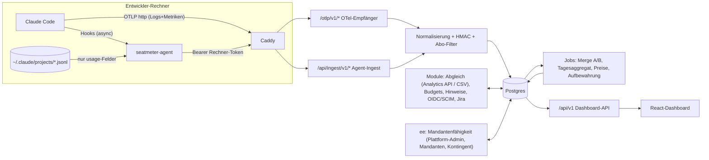

# seatmeter – Architektur

## 0. Festlegungen (Daniel 2026-10-22, ergänzt 2026-10-23)

Diese Festlegungen gehen den übrigen Abschnitten vor, wo sie davon abweichen.

- **Pilot-Konto:** Der Pilot läuft mit dem Firmen-Claude-Konto von weeberwrk. Den Plan dieses Kontos prüfen; ist es ein Team-Konto, Quelle A über Server-Managed Settings ausrollen.
- **Öffentlicher Ingest-Endpunkt:** eigener Ingest-Host (z. B. `ingest.example.com`) über einen Tunnel, nur die Ingest-Pfade (`/otlp/*`, `/api/ingest/*`, `/api/agent/*`).
- **ee-Lizenz:** eigener kurzer Entwurf (über `recht-de`), Vorbild Elastic License 2.0 bzw. GitLab EE.
- **Bereichstrennung im Pilot:** Quelle A nur über den Start-Wrapper für den weeberwrk-Bereichsordner; Agent B nur als Sweeper auf den weeberwrk-Transkriptordner; keine globalen Hooks.
- **Sitzkosten-Verteilung:** Standard nach Nutzungsanteil (Variante „person“); Sitze ohne Nutzung landen im Topf „ungenutzt“ (in Abschnitt 5 „Leerlauf“ genannt).
- **Überschreitung:** als eigene Zeile; ihr Anteil wird aus dem Schattenpreis herausgerechnet (Abschnitt 4 und 5).
- **Aufbewahrung:** 90 Tage Einzelanfragen / 13 Monate Tagesaggregat mit Person / 24 Monate Monatsabschluss, wie Abschnitt 3.5.
- **Auswertungsstufe:** Stufe 1 ist Standard; Klarnamen nur per Opt-in des Mandanten.
- **Währung:** EUR; Umrechnung mit dem EZB-Monatsmittel.
- **Agent-Verteilung:** Installskript plus Binary aus den Forgejo-Releases; keine Apple-Notarisierung in v1.
- **Hinweise:** Projekt-Hinweise gehören zu `ee/`, Datenqualitäts-Hinweise sind frei (Kern). Überholt durch „Open Core“ (2026-10-23): auch Projekt-Hinweise sind Kern.
- **Open Core (Daniel 2026-10-23):** `ee/` enthält nur noch die **Mandantenfähigkeit**: Lizenzprüfung, Plattform-Admin, Mandanten anlegen, ändern und löschen, Kontenkontingent, Plattform-Protokoll und den Plattform-Bereich im Dashboard. Alles andere ist Kern (Apache-2.0) und läuft ohne Lizenz: Budgets und Alarme, Projekt-Hinweise, Abgleich, Jira, OIDC/SSO (global und je Mandant), Domains, Konten und Einladungen, SCIM und die Selbstverwaltung eines Mandanten. Eine Installation für eine Organisation ohne `ee/` hat jede Funktion. Umgesetzt am 2026-10-24 (Abschnitt 8 und 14, „Umzug in den Kern“).

Entwurf v0.1 vom 2026-10-22, Projekt startup (weeberwrk). Produktentscheidungen stammen von Daniel (2026-10-22) und werden hier nicht neu verhandelt.
Belegte Fakten tragen einen Link in Abschnitt 13, alles Unbelegte steht als „nicht verifiziert“ in Abschnitt 12.

## 1. Überblick und Begriffe

seatmeter zählt, wie viele Tokens jede Person und jedes Projekt in Claude Code verbraucht, und zwar **nur die Nutzung über Abo-Sitze** (Claude Team/Enterprise), nie API-Key-Verkehr.
Aus den Zählern entsteht ein **Projektpreis** für die Kundenkalkulation: Schattenpreis zu API-Listenpreisen plus Anteil der Sitzkosten, dazu Budgets und Hinweise je Projekt.
Gespeichert werden nur Zähler und Metadaten, nie Inhalte (keine Prompts, Antworten, Tool-Eingaben, Dateinamen, Branch-Namen).

| Begriff | Bedeutung |
|---|---|
| **Mandant** | Kundenfirma. Besitzt eine oder mehrere Anthropic-Organisationen (`organization.id`), eigenes Salt, Preistabelle, Sitzkosten, Rollen. Die Free-Edition kennt genau einen Mandanten. |
| **Person / Pseudonym** | Ein Claude-Konto. Gespeichert wird nur `HMAC-SHA256(Mandantensalt, Kennung)`; angezeigt als Kurzcode `P-K7Q2MX`. Klarnamen nur, wenn der Mandant sie einschaltet. |
| **Projekt** | Ein Git-Repo, erkannt an der normalisierten `origin`-URL (= Kunde). Optional Feld `kunde` zur Gruppierung mehrerer Repos. Sonderprojekt „unzugeordnet“. |
| **Katalog-Projekt** | Projekt aus dem Projektmanagement-Werkzeug des Mandanten (externe ID, Nummer, Name, Kunde, optional Elternprojekt). Mehrere Repos dürfen zu einem Katalog-Projekt gehören; siehe `docs/Projektkatalog.md`. |
| **Sitzung** | Eine Claude-Code-Sitzung (`session.id`). |
| **Anfrage** | Ein API-Request von Claude Code, kleinste Zähleinheit, Schlüssel `request_id` (`req_…`). |
| **Quelle A** | OpenTelemetry-Export von Claude Code, organisationsweit per (Managed) Settings. |
| **Quelle B** | Lokaler Agent nach CCAM-Muster: Hooks plus Transkript-Zähler, Push mit Rechner-Token. |
| **Quelle C** | Abgleich: Enterprise Analytics API oder Team-Spend-Report (CSV). |
| **Abo-Nutzung** | Anfrage über OAuth-Login einer Org des Mandanten. Gegenteil: API-/Provider-Nutzung (gefiltert) und Fremd-Org (gefiltert). |
| **Überschreitung** | Nutzung über das Sitzkontingent hinaus, bezahlt als Usage Credits (echte Kosten in USD). |
| **Schattenpreis** | Was die Abo-Nutzung zu API-Listenpreisen gekostet hätte (kalkulatorisch, nicht bezahlt). |

## 2. Komponenten



### 2.1 OTel-Empfänger (packages/server, Modul `ingest-otlp`)
- Endpunkte `POST /otlp/v1/logs` und `POST /otlp/v1/metrics`. Claude Code hängt diese Pfade an `OTEL_EXPORTER_OTLP_ENDPOINT=https://<host>/otlp` an.
- **Protokolle v1: `http/protobuf` und `http/json`.** Kein gRPC in v1: `otelHeadersHelper` (dynamische Header, unser Rechner-Token) gibt es nur für die HTTP-Protokolle, HTTP läuft ohne Sonderport durch Caddy, Node-gRPC wäre zusätzliche Last. Falls ein Kunde gRPC braucht: OTel Collector (contrib) davor, gRPC rein, `otlphttp` raus, Header durchreichen (Spike, nicht verifiziert).
- Protobuf-Decoding mit `protobufjs` und den offiziellen `opentelemetry-proto`-Definitionen (Apache-2.0, vendored). JSON: camelCase, int64 als String.
- Auth: `Authorization: Bearer <token>`; Mandanten-Token (`smi_…`) oder Rechner-Token (`smr_…` über `otelHeadersHelper`). Nur SHA-256 des Tokens liegt in der DB.
- **Allowlist statt Blocklist.** Übernommen werden nur:
  - Ereignis `claude_code.api_request` mit `session.id`, `organization.id`, `user.account_uuid`, `user.account_id`, `user.email` (sofort HMAC), `model`, `input_tokens`, `output_tokens`, `cache_read_tokens`, `cache_creation_tokens`, `request_id`, `client_request_id`, `speed`, `query_source`, `cost_usd_micros`, `event.timestamp`, `vcs.*`, Ressource `service.name`/`service.version`/`os.type`; dazu `seatmeter.issue_schluessel` (Ereignis oder Ressource, nur Schlüssel wie `ABC-123`, Phase 5c).
  - Ereignis `claude_code.auth` (nur `action`, `success`, `auth_method`) für die Auth-Klasse.
  - Metriken `claude_code.token.usage`, `claude_code.cost.usage`, `claude_code.session.count` als Kontrollsummen.
  - Alles andere (z. B. `user_prompt`, `tool_result`, `api_request_body`, Attribute `prompt`, `tool_parameters`, `tool_input`) wird vor jeder Speicherung verworfen; gezählt wird nur „x Ereignisse mit Inhaltsattributen verworfen“ (Beleg für den Betriebsrat).
- Antworten nach OTLP-Spezifikation: 200 mit `partialSuccess`, 401 bei falschem Token, 503 mit `Retry-After`, wenn die DB fehlt (SDK wiederholt). Körper max. 4 MB, Rate-Limit je Token. Logs enthalten nie Attribute oder Körper.
- Die Ereignisse (Logs) sind die **Zählbasis**, weil nur sie `request_id` tragen. Metriken dienen als Vollständigkeitskontrolle je Sitzung/Modell/Tokentyp (Temporalität Standard `delta`).

### 2.2 Lokaler Agent (packages/agent, CLI `seatmeter-agent`)
- TypeScript, gebündelt mit esbuild. Auslieferung als Einzeldatei-Binary (Node SEA oder `bun --compile`, Spike in Phase 2), weil Claude Code nativ installiert sein kann und Node dann fehlt. Fallback: JS-Bundle mit vorhandenem Node ≥ 22.
- Befehle: `enroll <code>` (Einmalcode → Rechner-Token, abgelegt im OS-Schlüsselbund bzw. Datei 600), `install [--hooks|--sweeper-only]`, `hook <Event>`, `scan`, `push`, `otel-headers` (für `otelHeadersHelper`), `status`, `uninstall`.
- **Hooks** (vom Installer in `~/.claude/settings.json` gemischt, fremde Hooks bleiben, wie CCAM `install-hooks`): `SessionStart` (Sitzung anmelden, Auth-Hinweis), `Stop` und `SubagentStop` (inkrementell scannen und pushen), `SessionEnd` (letzter Lauf). Alle `"async": true`, Exec-Form, Prozess endet immer mit 0 (CCAM-Prinzip „blockiert Claude Code nie“).
  Aus dem Hook-JSON liest der Agent nur `session_id`, `transcript_path`, `cwd`, `hook_event_name`; `tool_input`, `last_assistant_message` usw. werden nicht angefasst. Deshalb **keine HTTP-Hooks direkt an den Server**: der Hook-Körper enthält Inhalte.
- **Sweeper** (launchd/systemd-Timer/Aufgabenplanung, alle 5–15 min): scannt geänderte Transkripte inkl. `<session>/subagents/*.jsonl`, fängt verlorene Hooks und das asynchrone Nachschreiben des Transkripts ab. Betriebsart „nur Sweeper“ ohne Hooks ist möglich (Pilot, siehe 10.4).
- **Transkript-Zähler:** liest nur Zeilen mit `type == "assistant"` und daraus `requestId`, `message.id`, `message.model`, `message.usage.{input_tokens, output_tokens, cache_read_input_tokens, cache_creation_input_tokens, cache_creation.ephemeral_5m_input_tokens, cache_creation.ephemeral_1h_input_tokens, speed, service_tier, inference_geo, server_tool_use.*}`, `timestamp`, `sessionId`, `cwd`, `isSidechain`, `version`. `message.content` wird nie gelesen (Parser verwirft das Feld beim Einlesen).
  Mehrere Zeilen je `message.id` (Streaming, ein Datensatz je Content-Block): **letzte Zeile gilt**, Abgleich über eine begrenzte Map `message.id → Beitrag` (CCAM `rememberUsageContribution`, 1000 Einträge). Lokal beobachtet: 1786 Assistant-Zeilen, 956 verschiedene `message.id` = 956 verschiedene `requestId`.
  Zustand je Datei (Inode, Offset, offene Map) in `~/.seatmeter/state.json`; Rückfüllung höchstens so weit, wie Transkripte liegen (Standard 30 Tage, `cleanupPeriodDays`).
- **Projekt-Erkennung:** je `cwd` einmal `git rev-parse --show-toplevel` und `git config --get remote.origin.url` mit bereinigter Umgebung (`GIT_DIR`, `GIT_WORK_TREE` … entfernt, CCAM `git-env`), dann dieselbe Normalisierung wie Claude Code (Abschnitt 3.3). Home-Verzeichnis als Repo zählt nicht.
- **Auth-Hinweis** (nur für Sitzungen ohne Quelle A): `api`, wenn im Hook-Env `ANTHROPIC_API_KEY`, `ANTHROPIC_AUTH_TOKEN`, `CLAUDE_CODE_USE_BEDROCK|VERTEX|FOUNDRY` oder ein abweichendes `ANTHROPIC_BASE_URL` gesetzt ist oder `apiKeyHelper` in User-/Managed-Settings steht; sonst `oauth` mit `organizationUuid`/`accountUuid` aus `~/.claude.json` (`oauthAccount`, undokumentiert). Heuristik, siehe 4.
- **Pfad-Filter:** `include_paths`/`exclude_paths` im Agenten; Sitzungen außerhalb verlassen den Rechner nicht. Wichtig für Freiberufler mit mehreren Auftraggebern und für Daniels Bereichstrennung.
- Push: `POST /api/ingest/v1/anfragen`, Batch ≤ 1000 Einträge, je Anfrage ein Datensatz (keine Summen), idempotent über `request_id`; Warteschlange auf Platte bei Ausfall. Gesendet werden nie: Inhalte, `cwd`, Dateipfade, Hostnamen, Branch-Namen (ab Agent 0.1.3 nur der daraus erkannte Issue-Schlüssel, Phase 5c). Die E-Mail wird nicht gesendet (Person über Rechnerbindung bzw. `accountUuid`).

### 2.3 Server/API (packages/server)
- Node 24 LTS, TypeScript, Fastify (Schema-Validierung, eigener Content-Type-Parser für Protobuf), zod-Schemas aus `packages/shared`, OpenAPI daraus erzeugt.
- DB-Zugriff mit Kysely (typisiertes SQL) und Kysely-Migrator; Postgres 18.
- Module: `ingest-otlp`, `ingest-agent`, `enrollment`, `merge` (A/B-Zusammenführung), `aggregation` (Tagesaggregat, nachts für die letzten 35 Tage plus bei Bedarf), `preise`, `kalkulation`, `berichte` (Betriebsrat, Projektabrechnung CSV), `aufbewahrung`, `auth` (lokal), `audit`, `issues`, `ausrollen`, `mandant` (Einstellungen und Selbstverwaltung), seit 2026-10-24 auch `budgets`, `hinweise`, `abgleich`, `jira`, `oidc`, `konten` und `scim`. Erweiterungspunkt `SeatmeterPlugin` (Routen, Jobs, Auth-Provider, Auth-Erweiterungen, Navigation) für `ee/` (Mandantenfähigkeit).
- Endpunkte: `/otlp/v1/{logs,metrics}`, `/api/ingest/v1/{anfragen,sitzungen,projektwahl}`, `/api/agent/v1/{enroll,config,heartbeat}`, `/api/health`, `/api/health/ingest`, `/api/v1/…` (Dashboard).
- Modul `projektkatalog` (Kern, 2026-11-01): Projektliste je Mandant: im Regelfall Push je Projekt aus dem Quellsystem (`PUT /api/v1/projektkatalog/projekte/:externalId`, Antwort immer 200 außer bei echten Fehlern, Token `smk_` vom Zweck `katalog_api`, Signal bei ausbleibender Synchronisation über `sync-status` mit eigenem Lese-Token `sync_status`, Job `projektkatalog.sync`; Altern nur gesendeter Projekte gegen den letzten Push, mit Bremse), daneben Listen aus einer `ProjektQuelle` für den Erstbestand (CSV aus Dashboard, Upload-Route mit Token vom Zweck `csv_import` oder CLI; JSON-Import). Schlüssel ist die externe ID, die Nummer nur Anzeige; `parent_externe_id` ohne Fremdschlüssel ergibt den Baum (`packages/shared/src/projektkatalog-baum.ts`), Zuordnung Repo → Katalog-Projekt getrennt von den Nutzungsdaten (rückwirkend, korrigierbar; der Monatsabschluss friert den Stand ein), Kosten je Katalog-Projekt, erzwungene Projektwahl über einen verwalteten `UserPromptSubmit`-Hook. Das Repo kommt aus Quelle A (`vcs.*`), die Zuordnung braucht keinen Agenten. Ordner ohne Repo: Wahl je Sitzung, Zurechnung über die Sitzungs-ID (geprüft mit Claude Code 2.1.316: `session_id` im Hook = `session.id` in OTel). Rolle `entwickler`: nur Projektwahl. Details: `docs/Projektkatalog.md`, `packages/server/src/projektkatalog/README.md`.

### 2.4 Dashboard (packages/web)
- React, Vite, TypeScript, Tailwind wie das Vorbild; TanStack Query, schlichte Diagramme (Recharts). Kein WebSocket, Abfrage beim Seitenaufruf genügt.
- Seiten: Übersicht (Monat: Tokens, Schattenpreis, Sitzkosten, Projektpreise), Projekte (Liste, Detail je Modell/Tokentyp, Personen je Auswertungsstufe), Personen (Pseudonyme), Preise und Sitzkosten, Rechner/Agenten (Einmalcodes, zuletzt gesehen, Versionen), Datenqualität (Abdeckung A/B, unzugeordnet, gefilterte API-/Fremd-Org-Anfragen nur als Anzahl, verworfene Inhaltsereignisse), Berichte (Betriebsrat, Projektabrechnung), Einstellungen.
- Seiten der Einrichtung (Kern): Budgets und Alarme, Projekt-Hinweise, Abgleich, Tokens und Orgs (eigener Mandant), SSO und Konten, Jira, Projektkatalog; in der Auswertung zusätzlich Jira-Kosten und Projektkosten. Außerhalb des Layouts die Auswahlseite `/projektwahl/<token>` hinter dem Link des Hooks. ee-Seiten gibt es nur im Plattform-Bereich: Mandanten, Lizenz, Protokoll.
- Navigation nach Rollen (Entscheidung Daniel 2026-10-23): Seitenleiste in den Gruppen **Auswertung** (alle Rollen: Übersicht, Projekte, Projektpreise, Personen, Rechner/Agenten, Datenqualität, Berichte, Systemzustand) und **Einrichtung** (Mandanten-Admin des aktiven Mandanten und Plattform-Admin: Einstellungen, Preise & Sitzkosten, Ausrollen, Budgets und Alarme, Projekt-Hinweise, Abgleich, Tokens und Orgs, SSO und Konten, Jira). **Plattform** (nur Plattform-Admin) ist ein eigener Bereich unter `/plattform` mit Unternavigation (Mandanten, Lizenz, Protokoll) und Link zurück ins Dashboard, erreichbar nur über „Plattform-Bereich“ in der Kopfzeile. Die Kopfzeile zeigt den aktiven Mandanten (Wechsel ab zwei Mandanten), Anmeldename · Rolle und für Plattform-Admins zusätzlich „Plattform“. Umsetzung: Abschnitt 14, „Navigation nach Rollen“.

### 2.5 Preismodul (packages/shared/preise, Server-Modul `preise`)
- Preistabelle je Modell-**Präfix** (längster Präfix gewinnt; CCAMs `LIKE`-Muster haben genau hier Fehler erzeugt, `claude-opus-5%` traf `claude-opus-5-5`), mit `gueltig_ab`.
- Spalten je MTok in USD: `input`, `output`, `cache_read`, `cache_write_5m`, `cache_write_1h`, `fast_input`, `fast_output`, optional Langkontext-Schwelle (`prompt_schwelle_tokens`) mit Zweitpreisen (z. B. Haiku 5.5 > 100k).
- Modifikatoren: `inference_geo = us` × 1,1 (ab Claude 4.6), Fast-Mode-Sätze mit Cache-Multiplikatoren darauf.
- Startwerte aus der offiziellen Preisseite (Stand 2026-10-22), mit Quelle und Prüfdatum je Zeile. Den CCAM-Seed nicht übernehmen (Beispiel: Sonnet 5.5 Cache-Read dort 0,20 $, offiziell 0,10 $).
- Wir rechnen selbst und verwenden `cost_usd` aus OTel nur als Kontrolle, weil der Kunde es per `modelPricing` auf Vertragspreise umstellen kann.

### 2.6 Abgleich-Modul (Kern, Modul `abgleich`)
- **Enterprise:** täglicher Abruf der Enterprise Analytics API (Beta) mit Kunden-Schlüssel (Scope `read:analytics`, verschlüsselt gespeichert):
  - `GET /v1/organizations/analytics/user_usage_report?products[]=claude_code&group_by[]=model&bucket_width=1d` – Tokens je Person/Tag/Modell, nur Sitz-Nutzer (kein API-Key-Verkehr). Vergleichsbasis für die Abo-Zählung.
  - `GET /v1/organizations/analytics/user_cost_report?products[]=claude_code&group_by[]=model&bucket_width=1d` – `amount` (nach Rabatt, vor Gutschrift) und `list_amount` je Person/Tag. Grundlage für den Abzug der Überschreitung.
  - Verknüpfung über `actor.user_id` (getaggte ID) = OTel `user.account_id`. `email_address`/`name` aus der Antwort werden sofort gehasht bzw. verworfen.
- **Team:** keine API. Upload des Spend-Report-CSV aus den Org-Analytics (Tokens und geschätzte Usage-Credit-Ausgaben je Person und Modell, täglich aktualisiert; Spaltenformat nicht verifiziert).
- Ergebnis: Tabelle `ueberschreitung`, Abweichungsbericht je Person/Tag (Schwelle z. B. ±3 %), Hinweis bei fehlender Abdeckung.

## 3. Datenmodell (Postgres)

Alle Tabellen tragen `mandant_id`; Row-Level-Security ab Tag 1 (`SET LOCAL app.mandant_id` je Transaktion, DB-Rolle ohne `BYPASSRLS`). Zeitstempel in UTC, Tagesgrenzen in der Mandanten-Zeitzone (Standard Europe/Berlin).

### 3.1 Tabellen

| Tabelle | Schlüssel | Wichtige Spalten |
|---|---|---|
| `mandant` | `id` | `name`, `slug`, `plan` (team, enterprise, max_pilot), `abrechnungsmodell` (kontingent, nutzungsbasiert), `auswertungsstufe` (0–3), `klarnamen_aktiv`, `zeitzone`, `waehrung`, `sitzkosten_verteilung` (person, gleich, pool), `code_anteil_sitz` (Standard 1,0), `schatten_faktor` (Standard 1,0), `cache_write_annahme` (1h) |
| `mandant_geheimnis` | `mandant_id` | `person_salt`, `projekt_salt` (je 32 Byte), `analytics_key` (Abgleich); alles mit AES-256-GCM unter `SEATMETER_MASTER_KEY` verschlüsselt |
| `anthropic_org` | (`mandant_id`, `org_uuid`) | `bezeichnung`, `plan`, `gueltig_ab` – Positivliste für den Abo-Filter |
| `ingest_token` | `id` | `typ` (mandant, rechner), `rechner_id`, `token_sha256` (unique), `praefix`, `erstellt`, `zuletzt_genutzt`, `widerrufen` |
| `einmalcode` | `code_sha256` | `person_id` (optional), `laeuft_ab` (24 h), `genutzt_am` |
| `rechner` | `id` | `person_id`, `bezeichnung` (vom Admin), `os`, `agent_version`, `registriert`, `zuletzt_gesehen`, `widerrufen` |
| `person` | `id`; unique (`mandant_id`, `key_konto`), (`mandant_id`, `key_email`) | `pseudonym` (`P-` + 6 Zeichen Base32 aus eigenem HMAC-Label), `key_konto` = HMAC(account_id bzw. account_uuid), `key_email` = HMAC(lower(email)), `erste_nutzung`, `letzte_nutzung` |
| `person_klar` | `person_id` | `email_enc`, `name_enc` – nur befüllt, wenn `klarnamen_aktiv` |
| `person_sitz` | (`person_id`, `gueltig_ab`) | `sitz_typ` (standard, premium, enterprise, max5, max20), `gueltig_bis` |
| `sitzkosten` | (`mandant_id`, `sitz_typ`, `gueltig_ab`) | `preis_monat`, `waehrung`, `abrechnung` (monatlich, jährlich) |
| `projekt` | `id`; unique (`mandant_id`, `projekt_key`) | `projekt_key` = HMAC(projekt_salt, url_norm), `url_norm` (nullbar bei „nur Hash“), `repo_name`, `owner`, `provider`, `anzeigename`, `kunde` |
| `projekt_alias` | (`mandant_id`, `projekt_key`) | `projekt_id` – führt URL-Varianten (HTTPS/SSH, Umzug) zusammen |
| `sitzung` | (`mandant_id`, `session_id`) | `person_id`, `rechner_id`, `projekt_id` (erstes), `org_uuid`, `auth_klasse` (abo, api, provider, fremd_org, unbekannt), `quellen` (Bitmaske A=1, B=2), `cc_version`, `start`, `ende` |
| `anfrage` (monatlich partitioniert) | (`mandant_id`, `anfrage_key`) | `anfrage_key` = `request_id`, sonst `msg:<message.id>`; `ts`, `tag`, `session_id`, `person_id`, `projekt_id`, `model`, `speed`, `inference_geo`, `service_tier`, `query_source`, `ist_subagent`, `input`, `output`, `cache_read`, `cache_write`, `cache_write_1h` (nullbar), `web_search`, `quellen`, `auth_klasse`, `zaehlt_als_abo`, `cc_kosten_usd_micros`, `abweichung_ab` (Tokens A≠B) |
| `otel_kontrollsumme` | (`mandant_id`, `tag`, `session_id`, `model`, `typ`, `query_source`) | `wert` – Summen aus `claude_code.token.usage` |
| `tag_aggregat` | (`mandant_id`, `tag`, `person_id`, `projekt_id`, `model`, `speed`, `auth_klasse`) | Tokens je Typ, `anfragen`, `schatten_usd_micros`, `preis_version`, `abo_anteil` (nach Abzug Überschreitung) |
| `monatsabschluss` | (`mandant_id`, `monat`, `projekt_id`) | eingefrorene Werte: Schatten, Sitzanteil, Überschreitung, Projektpreis, Kurs, Preisversion |
| `kurs` | (`mandant_id`, `monat`) | `usd_eur` (EZB-Monatsmittel oder vom Mandanten gesetzt) |
| `preis` | `id`; unique (`mandant_id` nullbar = global, `modell_praefix`, `gueltig_ab`) | Sätze laut 2.5, `quelle_url`, `geprueft_am` |
| `ueberschreitung` | (`mandant_id`, `tag`, `person_id`, `model`) | `amount_usd_micros`, `list_amount_usd_micros`, Tokens je Typ, `quelle` (api, csv) |
| `abgleich_lauf` | `id` | `zeitraum`, `status`, `abweichungen` (Zusammenfassung ohne Personendaten) |
| `budget` / `alarm` | `id` | `projekt_id`, `zeitraum`, `betrag`, `basis` (projektpreis, tokens), `schwellen` {50, 80, 100}; `alarm`: `schwelle`, `ausgeloest`, `wert`, `quittiert` |
| `benutzer` / `rolle` | `id` | `login` (lokal, oidc), `oidc_sub`, `passwort_hash` (argon2id); `rolle`: `mandant_id`, `rolle`, `projekt_ids` |
| `audit` | `id` | `benutzer_id`, `aktion` (z. B. „Personensicht geöffnet“, „Export“, „Ansicht“), `objekt`, `ts` – ohne Personendaten der Gezählten |
| `ingest_statistik` | (`mandant_id`, `tag`, `quelle`) | `angenommen`, `verworfen_inhalt`, `verworfen_api`, `verworfen_fremd_org`, `unzugeordnet` |

### 3.2 Pseudonymisierung
- `key = HMAC-SHA256(person_salt, normalisierte Kennung)`; E-Mail: getrimmt, klein. Primärkennung ist `user.account_id`/`account_uuid` (stabil bei E-Mail-Wechsel, passt zur Analytics API); `key_email` dient dem Team-CSV und der Sitzliste.
- Hashing passiert im Request-Handler vor jeder Speicherung und vor jedem Log. Rohwerte liegen nie in der DB (außer `person_klar` bei eingeschalteten Klarnamen).
- Klarnamen nachträglich: Der Mandanten-Admin lädt eine Liste (E-Mail, Name, Sitztyp) aus der claude.ai-Mitgliederverwaltung hoch; der Server hasht, ordnet zu und verwirft die Liste. Ohne Klarnamen-Freigabe bleiben nur Sitztypen hängen.
- Pseudonymisierte Daten bleiben personenbezogen (das Salt liegt beim Betreiber). weeberwrk ist Auftragsverarbeiter, AVV nötig.
- Salt-Rotation erzeugt neue, nicht verknüpfbare Pseudonyme. Angeboten nur als bewusster „Pseudonym-Neustart“ (z. B. zum Jahreswechsel).

### 3.3 Projekt-Erkennung
- Quelle A: `vcs.repository.url.full`, `vcs.owner.name`, `vcs.repository.name`, `vcs.provider.name`. Voraussetzung: `OTEL_METRICS_INCLUDE_REPOSITORY=true` und Claude Code ≥ 2.1.269. Claude Code leitet das einmal je Sitzung aus `origin` ab: klein geschrieben, ohne `.git`, Zugangsdaten, Query und Fragment.
- Quelle B: dieselbe Normalisierung im Agenten (`packages/shared/repo-url.ts`) mit Testvektoren gegen echte Claude-Code-Ausgaben (HTTPS, SSH, Forgejo mit Port 2222). Abweichungen fängt `projekt_alias` ab.
- `projekt_key = HMAC(projekt_salt, url_norm)`. Klartext-URL und Name standardmäßig gespeichert (die Repos gehören dem Mandanten). Option „nur Hash“: dann vergibt der Admin Anzeigenamen.
- Sitzung über mehrere Repos: A liefert ein Repo je Sitzung, B das `cwd` je Anfrage. **B gewinnt je Anfrage.** Ohne Remote landet die Anfrage in „unzugeordnet“.

### 3.4 Dedup zwischen A und B
1. Schlüssel `(mandant_id, request_id)`: A aus `claude_code.api_request.request_id`, B aus `requestId` der Assistant-Zeile (laut Doku dieselbe ID). Upsert setzt die Bits in `quellen`.
2. Fehlt `request_id` (A nur, wenn die Antwort den Header trägt; ältere Versionen): B nutzt `msg:<message.id>`. Danach prüft die Heuristik, ob es dieselbe Anfrage ist: `session_id`, `model`, `ts` ± 2 s und das exakte Tupel (`input`, `output`, `cache_read`, `cache_write`). Treffer werden zusammengeführt und als heuristisch markiert.
3. Feldvorrang: Token-Summen aus A (Claude Code zählt jede Streaming-Antwort genau einmal), sonst B. Die 5m/1h-Aufteilung nur aus B. Projekt aus B, sonst A. Person aus A (Konto), sonst aus der Rechnerbindung. Auth-Klasse aus A, sonst der Hinweis aus B. Wenn die Tokens von A und B auseinanderliegen, setzt der Merge `abweichung_ab` und zählt das in der Datenqualität.
4. Vollständigkeit: Σ `anfrage` je Sitzung/Modell/Typ gegen `otel_kontrollsumme`, angezeigt als Abdeckung in %.

### 3.5 Aufbewahrung (Standard, je Mandant änderbar)

| Daten | Standard | Umsetzung |
|---|---|---|
| `anfrage` (Einzelanfragen) | 90 Tage | Monatspartitionen, `DROP PARTITION` |
| `tag_aggregat` mit Person | 13 Monate | nächtlicher Löschjob |
| `monatsabschluss` je Projekt (ohne Person) | 24 Monate | nächtlicher Löschjob |
| `otel_kontrollsumme`, `ingest_statistik` | 30 Tage / 13 Monate | nächtlicher Löschjob |
| `audit` | 24 Monate | nächtlicher Löschjob |

Jeder Löschlauf wird protokolliert und erscheint im Betriebsrats-Bericht.

## 4. „Nur Abo“-Regel

**Grundregel:** Eine Anfrage zählt als Abo, wenn sie über ein Claude-Konto einer Org des Mandanten lief (`zaehlt_als_abo = true`). Alles andere wird nur als Anzahl in der Datenqualität geführt, ohne Personen- oder Projektbezug.

| Fall | Erkennung | Ergebnis |
|---|---|---|
| OAuth-Login (Team/Enterprise) | A: `organization.id` und `user.account_uuid`/`user.email` vorhanden, `organization.id` ∈ `anthropic_org` | **abo** |
| Direkter API-Key, Bedrock, Vertex, Foundry | A: nur `user.id` und `session.id`, kein Konto (laut Doku) | api/provider, verworfen |
| Claude-Konto einer fremden Org (privates Pro/Max, Console-Login) | A: `organization.id` nicht in der Positivliste | fremd_org, verworfen |
| Claude-apps-Gateway | A: `identity.source = gateway-oidc` | provider, verworfen |
| `CLAUDE_CODE_OAUTH_TOKEN` (setup-token, CI) | A: OAuth mit Org des Mandanten | abo (verbraucht wirklich Sitzkontingent), markiert über `app.entrypoint`/`query_source` |
| Nur Quelle B | Auth-Hinweis laut 2.2 + `organizationUuid` aus `~/.claude.json` | abo/api, Kennzeichen „Auth nicht bestätigt“ |

**Härtung (empfohlen, im Ausroll-Paket):** Managed `forceLoginMethod: "claudeai"` und `forceLoginOrgUUID: [<Org>]`. Damit blockiert Claude Code `ANTHROPIC_API_KEY`, `ANTHROPIC_AUTH_TOKEN` und `apiKeyHelper` schon beim Start; auf verwalteten Rechnern ist dann jede Sitzung Abo-Nutzung der richtigen Org. Server-Managed Settings erreichen ohnehin nur Sitzungen mit Credential dieser Org; ein Console-API-Key bekommt unsere Telemetrie-Konfiguration also gar nicht erst.

**Abzug der Überschreitung (Abrechnungsmodell „kontingent“):**
- Je Person p und Tag d: Überschreitung zum Listenpreis `ü_list(p,d)` (`list_amount`, sonst `amount`) und echte Kosten `ü(p,d)` (`amount`).
- `S(p,d)` = Schattenpreis der Abo-Anfragen von p an d. Überschreitungsanteil `u(p,d) = min(1, ü_list / S)`.
- Abo-Anteil der Tokens und des Schattenpreises: `× (1 − u(p,d))`. Die echten Kosten `ü(p,d)` werden nach dem Schattenanteil der Projekte von p an d verteilt und erscheinen als eigene Zeile „Überschreitung (bezahlt)“. So zählt nichts doppelt.
- Grenze: Die Quellen liefern Tageswerte, das Kontingent läuft in 5-Stunden- und Wochenfenstern. Die Zuordnung zu Projekten ist daher eine anteilige Näherung.
- Ohne Abgleich (kein Analytics-Key, Team ohne CSV): kein Abzug, Hinweis „Überschreitung nicht abgezogen“ im Bericht.

**Team, Enterprise und Pilot im Vergleich:**

| | Team | Enterprise mit Sitzkontingent (Altvertrag) | Enterprise nutzungsbasiert | Max (nur Pilot) |
|---|---|---|---|---|
| Nutzung im Sitz enthalten | ja (Standard/Premium, 5-h- und Wochenfenster) | ja | **nein**, Nutzung zu API-Preisen | ja (1 Person) |
| Quelle A per Server-Managed Settings | ja | ja | ja | nein (nur User-Settings/Wrapper) |
| Quelle A per MDM / `managed-settings.json` | ja | ja | ja | ja |
| Abgleich | Spend-Report-CSV (sobald Usage Credits an) | Analytics API + CSV | Analytics API + CSV | keiner |
| Überschreitung abziehbar | ja (CSV, Tageswerte) | ja | entfällt: alles ist bezahlte Nutzung | nein |
| Kalkulation | Schatten + Sitzanteil + Überschreitung | wie Team | **echte Nutzungskosten** (`amount` verteilt oder Schatten × Rabatt) + Sitzanteil | Schatten + Sitzanteil |

## 5. Kalkulation

**Formeln** (Monat M, Projekt P, Person p, Anfrage r mit Modell m zur Zeit t):
- Schattenpreis einer Anfrage: `S(r) = Σ_k n_k(r) · p_k(m,t) / 10^6 · f_geo · (Fast-Sätze statt Basis, falls speed = fast)`, k ∈ {input, output, cache_read, cache_write_5m, cache_write_1h}. Fehlt die 5m/1h-Aufteilung (nur A), gilt `cache_write_annahme` (Standard 1h; lokal sind alle Abo-Schreibvorgänge 1h).
- Projekt-Schatten: `S_P = Σ_{r ∈ P, abo} S(r) · (1 − u(p_r, d_r))`.
- Sitzkosten je Person: `K_p = Preis(Sitztyp_p, M) · code_anteil_sitz`.
- Sitzanteil, Standard „person“: `A_P = Σ_p K_p · S_{p,P} / S_p`. Personen ohne Nutzung (`S_p = 0`) landen im Topf „Leerlauf“, nicht bei Projekten.
  - Variante „gleich“: `A_P = Σ_p K_p / |Projekte von p|`.
  - Variante „pool“: `A_P = (Σ_p K_p) · S_P / Σ S`.
- Überschreitung: `Ü_P = Σ_{p,d} ü(p,d) · S_{p,d,P} / S_{p,d}`.
- **Projektpreis:** `PP_P = schatten_faktor · S_P + A_P + Ü_P` (USD), dann mal `kurs(M)` in EUR. Standard `schatten_faktor = 1,0` laut Entscheidung.
- Nutzungsbasiertes Enterprise: `S_P` ersetzt durch die echten Kosten (`amount` aus `user_cost_report`, verteilt wie Ü) oder Schatten × Vertragsrabatt.
- Der Monatsabschluss friert die Werte ein. Spätere Preis- oder Datenänderungen wirken nur auf offene Monate.
- **Budget:** Verbrauch `V_P(t)`, Prognose zum Monatsende `V_P(t) / w_t · w_M` (w = vergangene bzw. gesamte Arbeitstage). Alarm je Schwelle einmal (50/80/100 % von Verbrauch oder Prognose), Kanäle E-Mail und Webhook.

**Beispiel** (Listenpreise vom 2026-10-22 in USD je MTok; Opus 5.5: input 4, output 20, cache read 0,20, cache write 1h 8. Sonnet 5.5: 2, 10, 0,10, 4. Team-Premium jährlich 100 $/Monat, Team-Standard jährlich 20 $/Monat; Kurs 0,86 € je $ als Beispielwert.)

| Person | Projekt | Modell | Tokens (input / output / cache read / cache write 1h) | Schattenpreis |
|---|---|---|---|---|
| P-A (Premium) | x-shop | Opus 5.5 | 2 M / 1,5 M / 300 M / 20 M | 8 + 30 + 60 + 160 = **258 $** |
| P-A | y-portal | Sonnet 5.5 | 1 M / 0,5 M / 100 M / 5 M | 2 + 5 + 10 + 20 = **37 $** |
| P-B (Premium) | x-shop | Opus 5.5 | 1 M / 0,5 M / 150 M / 10 M | 4 + 10 + 30 + 80 = **124 $** |
| P-C (Standard) | – | – | keine Nutzung | 0 $ |

- Überschreitung: P-B hatte einen Tag mit 15 $ (`amount` = `list_amount`), alles in x-shop. Abzug am Schatten: x-shop 258 + 124 − 15 = **367 $**, y-portal **37 $**.
- Sitzanteil (Variante „person“): P-A 100 $ × 258/295 = 87,46 $ an x-shop und 12,54 $ an y-portal; P-B 100 $ an x-shop; P-C 20 $ an Leerlauf.
- x-shop: 367 + 187,46 + 15 = **569,46 $ ≈ 489,74 €**; y-portal: 37 + 12,54 = **49,54 $ ≈ 42,60 €**; Leerlauf 20 $ ≈ 17,20 €.
- Budget x-shop 600 €/Monat: Am Arbeitstag 14 von 21 sind 380 € verbraucht, Prognose 380 / 14 · 21 = 570 € (95 %). Die 80-%-Schwelle ist damit erreicht und löst Hinweis und Alarm aus.

## 6. Mandantenfähigkeit und Zugang

- **Ingest-Token:** Mandanten-Token für Quelle A (statischer Header in den Managed Settings, für alle Mitarbeitenden lesbar) oder Rechner-Token. Das Rechner-Token gilt für Quelle B und optional über `otelHeadersHelper = seatmeter-agent otel-headers` auch für Quelle A, ist an Rechner und Person gebunden, einzeln widerrufbar und kommt aus dem Schlüsselbund. Tokens werden nur einmal angezeigt. Präfixe `smi_`/`smr_`, damit Secret-Scanner sie erkennen.
- Fälschungsschutz: Mit dem Mandanten-Token kann jemand Nutzung für andere erfinden. Gegenmittel: Rechner-Token über den Helper, Plausibilität Person ↔ Rechner, Abgleich.
- **Dashboard-Login:**
  - Free: lokaler Admin (argon2id). Erstanmeldung über ein Einrichtungs-Token aus dem Server-Log; weitere lokale Konten mit Rollen.
  - OIDC (Kern seit 2026-10-24): globaler Anbieter des Betreibers (Authelia als Referenz, Gruppen-Claim → Rolle) und SSO je Mandant, dazu SCIM; zusätzlich Proxy-Header-Modus hinter vertrauenswürdigem Proxy.
  - Betrieb bei weeberwrk: Phase 1–3 Caddy `forward_auth` (Authelia) als äußeres Tor plus lokaler Admin; ab Phase 4 OIDC-Client `seatmeter` in Authelia, lokaler Admin nur noch für Notfälle.
- **Rollen:**

| Rolle | Darf |
|---|---|
| Plattform-Admin (ee) | Mandanten anlegen und sperren. Kein Zugriff auf Personensichten, außer per protokolliertem Support-Zugang mit Freigabe des Mandanten. |
| Mandanten-Admin | Einstellungen, Orgs, Tokens, Preise, Sitzkosten, Auswertungsstufe, Klarnamen, Benutzer |
| Projektleiter | zugewiesene Projekte: Preise, Budgets, Personen gemäß Stufe |
| Controller/Leser | alle Projekte aggregiert, keine Personen |
| Betriebsrat | Betriebsrats-Bericht, Konfiguration, Zugriffsprotokoll, Aggregate ohne Personen |

- Mandantentrennung: RLS plus Tests („Mandant A sieht nichts von B“) in jeder Pipeline. Die Free-Edition nutzt dasselbe Schema mit einem einzigen Mandanten.
- **Mandantenfähigkeit (ee):** Plattform-Admin, Mandanten anlegen, ändern und löschen, Kontenkontingent und Plattform-Protokoll. Sie hängt sich über `AuthErweiterung` in die Kern-Verwaltung (`/api/v1/mandant/…`) ein: Plattform-Admins verwalten jeden Mandanten mit `?mandant=<id>` (`mandantVerwalten`), sind in der Kontenverwaltung geschützt (`plattformAdmins`), kommen auf Wunsch aus OIDC-Gruppen (`plattformAdminAbgleichen`); das Kontingent prüft `kontingentPruefen`/`kontingentStand`. Ohne ee gibt es weder Plattform-Admins noch Kontingent.

## 7. Datenschutz-Standards und Betriebsrats-Bericht

**Standards (Voreinstellung):**
- Keine Inhalte, nur Zähler. Allowlist im Empfänger, Agent ohne Inhaltsfelder. Managed Settings setzen `OTEL_LOG_USER_PROMPTS=0`, `OTEL_LOG_ASSISTANT_RESPONSES=0`, `OTEL_LOG_TOOL_DETAILS=0` und `OTEL_LOG_RAW_API_BODIES=0` ausdrücklich, damit sie gesperrt sind.
- Pseudonyme Personen, Klarnamen aus. Auswertungsstufe 1 als Standard:

| Stufe | Personensicht |
|---|---|
| 0 „nur Projekte“ | keine; Personen dienen nur der Sitzkostenverteilung |
| 1 „Pseudonym, Monat“ (Standard) | Pseudonyme nur als Monatssummen, Mindestgruppe k = 3 je Ausweis |
| 2 „Pseudonym, Tag“ | Tagesverlauf je Pseudonym und Projekt |
| 3 „Klarnamen“ | nur nach Aktivierung durch den Mandanten-Admin mit Verweis auf die Betriebsvereinbarung, protokolliert |

- Nie Stunden- oder Uhrzeitsichten je Person (keine Arbeitszeitkontrolle). Einzelanfragen sind nicht im Dashboard sichtbar, nur in Aggregaten.
- Jeder Zugriff auf Personensichten, jeder Export und jede Ansicht eines Berichts landet im `audit`.
- Hosting in Deutschland (eigener Server, später EU-Hoster). TLS bis Caddy. Backups verschlüsselt. Master-Schlüssel getrennt von den Backups.

**Betriebsrats-Bericht** (HTML/PDF und CSV, Zeitraum wählbar):
1. Konfiguration: Auswertungsstufe, Klarnamen an/aus, Aufbewahrungsfristen, aktive Quellen, Änderungen im Zeitraum (wer, wann).
2. Erfasste Datenkategorien und ausdrücklich nicht erfasste (Inhalte, Prompts, Dateinamen, Uhrzeiten je Person).
3. Zugriffe: Konten mit Rollen; Protokoll, wer wann Personensichten geöffnet oder exportiert hat.
4. Mengen: Anzahl erfasster Personen und Rechner; Nutzung je Projekt ohne Personenbezug.
5. Datenschutznachweise: Zahl der verworfenen Ereignisse mit Inhaltsattributen, gefilterte API-/Fremd-Org-Anfragen (nur Anzahl), durchgeführte Löschläufe.
6. Version von seatmeter und Agent, Hinweis auf die Betriebsvereinbarung.

## 8. Monorepo-Layout und Lizenzgrenzen

```
seatmeter/                      pnpm workspaces, Node 24 LTS, TypeScript strict
├─ LICENSE                      Apache-2.0 (Kern)
├─ NOTICE                       Drittanbieter-Hinweise (CCAM MIT, falls Code übernommen; opentelemetry-proto)
├─ packages/
│  ├─ shared/                   zod-Schemas, Typen, Preislogik, Repo-URL-Normalisierung, HMAC-Helfer
│  ├─ server/                   Fastify, OTLP, Agent-Ingest, Jobs, Migrationen, Plugin-Schnittstelle,
│  │                            Budgets/Alarme/Hinweise, Abgleich, Jira, OIDC/SSO, Konten, SCIM
│  ├─ web/                      React/Vite-Dashboard
│  └─ agent/                    CLI, Hooks, Transkript-Zähler, Sweeper-Vorlagen (launchd/systemd/Task)
├─ ee/
│  ├─ LICENSE                   weeberwrk-Lizenz (Entwurf)
│  ├─ server/                   Mandantenfähigkeit: Lizenz, Plattform-Admin, Mandanten, Kontingent
│  └─ web/                      Plattform-Bereich (Mandanten, Lizenz, Protokoll)
├─ deploy/                      compose.yml, compose.dev.yml, Caddy-Schnipsel, Gatus-Beispiel, Backup-Skript
└─ docs/                        Betrieb, Ausrollen, Betriebsrats-Vorlage, Entscheidungen
```

- Grenze: `packages/*` importiert nie aus `ee/` (ESLint `no-restricted-imports`, CI-Prüfung). `ee` registriert sich als `SeatmeterPlugin`. Das Standard-Image (`runtime`) enthält alles außer der Mandantenfähigkeit; das Ziel `runtime-ee` bringt das ee-Plugin und die Seiten des Plattform-Bereichs mit, aktiv nur mit Lizenzschlüssel (signierte Datei, Ed25519).
- **Open Core (Stand 2026-10-24, Abschnitt 0):** Kern (Apache-2.0): Ingest, Kalkulation, Berichte, Ausrollen, Budgets und Alarme, Projekt-Hinweise, Abgleich, Jira, OIDC/SSO (global und je Mandant), Domains, Konten und Einladungen, SCIM, Selbstverwaltung des Mandanten. ee (weeberwrk-Lizenz): nur die Mandantenfähigkeit (Plattform-Admin, Mandanten anlegen/ändern/löschen, Kontenkontingent, Plattform-Protokoll, Lizenzprüfung, Plattform-Bereich). Lizenzmodul ist nur noch `mandanten`; ältere Lizenzdateien mit `oidc`, `budgets` oder `abgleich` bleiben gültig, die weiteren Einträge wirken nicht. Das Lizenz-Tor (402 `lizenz_fehlt`) gibt es nur auf den ee-Routen `/api/v1/ee/…`.
- Werkzeuge nur in Docker: `compose.dev.yml` mit `node:24-bookworm-slim` (corepack/pnpm) und `postgres:18`. `docker compose -f deploy/compose.dev.yml run --rm dev pnpm …` für lint (ESLint, Prettier), typecheck (tsc), test (Vitest gegen echte Postgres im Compose-Netz) und build. Später Playwright für das Dashboard.
- CI: Forgejo Actions mit denselben Containern. Release-Tag `vX.Y.Z` baut die Images (Forgejo Container Registry) und die Agent-Binaries (Release-Assets).
- Tests mit Pflicht: Golden-Test Kalkulation (Beispiel aus 5), Dedup A/B, Allowlist (Inhalte nie gespeichert), Repo-URL-Normalisierung, RLS-Trennung, Pseudonymisierung (kein Klartext in der DB: Volltextsuche nach Test-E-Mail im Dump).

## 9. Betrieb

Ein Container `server` (API, Ingest, Dashboard) und Postgres 18 hinter einem Reverse-Proxy mit TLS; Anleitung, Umgebungsvariablen und Beispiele in `deploy/README.md`.

- **Dienste:** `server` (Port 8080, externes Proxy-Netz plus internes Netz) und `postgres` (`postgres:18`, nur internes Netz, eigenes Volume). `.env` (600) mit `POSTGRES_PASSWORD`, `SEATMETER_MASTER_KEY`, später OIDC-Secret; eine Kopie der Geheimnisse im Passwort-Manager.
- **Reverse-Proxy** (z. B. Caddy), Dashboard-Host z. B. `seatmeter.example.com`:
  - `/otlp/*` und `/api/ingest/*`, `/api/agent/*` → Server **ohne** `forward_auth` (Bearer-Token); `Remote-*`-Header entfernen.
  - `/api/health` ohne Auth.
  - Rest: `forward_auth` (z. B. Authelia), der lokale Login der App oder OIDC in der App.
- **Öffentliche Annahme** (für Kundenrollouts): eigener Ingest-Host (z. B. `ingest.example.com`, etwa über einen Tunnel), nur Ingest-Pfade, Rate-Limit. Das Dashboard bleibt intern oder läuft öffentlich nur hinter einer Anmeldung.
- **Monitoring** (z. B. Gatus):
  - `seatmeter` (`/api/health` 200 inkl. DB-Ping, 60 s)
  - `seatmeter-ingest-stille` (`/api/health/ingest`, immer 200: Alarm, wenn Quelle B für Personen mit Agent-Daten fehlt, während A liefert; Umsetzung in 14, Phase 5)
  - `seatmeter-agenten` (`/api/health/ingest`: Alarm, wenn kein registrierter Rechner in den letzten 48 h ein Lebenszeichen geschickt hat)
- **Backups:** `deploy/backup.sh` nachts per Cron mit `pg_dump -Fc` (14 Tage, Prüfung mit `pg_restore -l`), verschlüsselt und außer Haus. Ein Heartbeat an das Monitoring meldet den Erfolg. Der Master-Schlüssel liegt getrennt (Passwort-Manager): ohne ihn sind die Salts und damit die Pseudonyme nicht reproduzierbar. Wiederherstellung einmal testen.
- **Migrationen:** Kysely-Migrator beim Serverstart unter Advisory-Lock, nur vorwärts, je Migration eine Transaktion. Vor jedem Update Backup; Rückweg = Restore. Neue Spalten zuerst nullbar, Pflicht erst im Folge-Release.
- Updates: neues Image bauen bzw. Tag ändern, `docker compose up -d server`; das Monitoring prüft.

**Umsetzungsnotizen (Phase 1b, 2026-10-22)** – Abweichungen vom Plan oben:

- **Ein Container statt zwei:** Der Server liefert das Dashboard-Build selbst aus (Modul `static`, `SEATMETER_WEB_DIST=/app/web` im Image, SPA-Rückfall außer für `/api/*` und `/otlp/*`). Es gibt keinen eigenen Web-Dienst; der Proxy spricht nur den Server auf Port 8080.
- **Image:** `Dockerfile` im Repo-Wurzelverzeichnis (mehrstufig, Laufzeit `node:24-bookworm-slim` als Benutzer `node`, `HEALTHCHECK` auf `/api/health`). Gebaut wird aus einem sauberen Klon von `main` als `seatmeter:<sha>` und `:latest`; vorher die Datenbank sichern, dann nur den Server erneuern (wenige Sekunden ohne Dienst). Keine Registry, kein Image-Build in der CI (erst später auf Tags `v*`).
- **Migrationen** laufen beim Serverstart; ein eigener Migrationsdienst entfällt.
- **Öffentliche Annahme:** eigener Ingest-Host, nur `/otlp/*`, `/api/ingest/*`, `/api/agent/*`, `/api/health`, sonst 404. Rate-Limit app-seitig (siehe 14), nicht im Proxy oder beim CDN.
- **Backup:** `deploy/backup.sh` mit `backup.env` (14 Tage, `pg_dump -Fc`, Prüfung mit `pg_restore -l`), Heartbeat an das Monitoring. Master-Schlüssel und DB-Passwort getrennt im Passwort-Manager.
- **Monitoring:** `seatmeter` (`/api/health`, Körper `db == ok`), Dashboard (302/401 = hinter der Anmeldung), öffentlicher Ingest (Health von außen, `/` = 404), Heartbeat des Backups.

Die konkrete Einrichtung bei weeberwrk (Hosts, Stack, Proxy, Backups) ist interne Betriebsdoku und nicht Teil des öffentlichen Exports.

## 10. Ausroll-Paket je Kunde

### 10.1 Vorbereitung (Mandanten-Admin mit weeberwrk)
Mandant anlegen, Org-UUID(s) aus claude.ai Admin Settings eintragen, Plan und Abrechnungsmodell wählen. Sitzliste (E-Mail, Sitztyp) hochladen; die E-Mails werden sofort gehasht. Preise prüfen, Auswertungsstufe mit dem Betriebsrat festlegen, Ingest-Token und Einmalcodes erzeugen.

### 10.2 Settings-Schnipsel (Platzhalter in spitzen Klammern)

```json
{
  "env": {
    "CLAUDE_CODE_ENABLE_TELEMETRY": "1",
    "OTEL_LOGS_EXPORTER": "otlp",
    "OTEL_METRICS_EXPORTER": "otlp",
    "OTEL_EXPORTER_OTLP_PROTOCOL": "http/protobuf",
    "OTEL_EXPORTER_OTLP_ENDPOINT": "https://<ingest-host>/otlp",
    "OTEL_EXPORTER_OTLP_HEADERS": "Authorization=Bearer <MANDANTEN-TOKEN>",
    "OTEL_METRICS_INCLUDE_REPOSITORY": "true",
    "OTEL_METRICS_INCLUDE_SESSION_ID": "true",
    "OTEL_METRICS_INCLUDE_ACCOUNT_UUID": "true",
    "OTEL_LOG_USER_PROMPTS": "0",
    "OTEL_LOG_ASSISTANT_RESPONSES": "0",
    "OTEL_LOG_TOOL_DETAILS": "0",
    "OTEL_LOG_RAW_API_BODIES": "0"
  },
  "forceLoginMethod": "claudeai",
  "forceLoginOrgUUID": ["<ORG-UUID>"]
}
```

| Weg | Für wen | Hinweise |
|---|---|---|
| a) MDM bzw. `managed-settings.json` | Firmen mit Geräteverwaltung | Pfade: macOS `/Library/Application Support/ClaudeCode/`, Linux `/etc/claude-code/`, Windows `C:\Program Files\ClaudeCode\`. Stärkste Bindung, Nutzer können es nicht ändern. |
| b) Server-Managed Settings (claude.ai → Organization settings → Claude Code → Managed settings) | **Team ohne MDM**, auch Enterprise | Owner-Rolle nötig; gilt einheitlich für alle (keine Gruppen). Bei `OTEL_EXPORTER_OTLP_ENDPOINT` erscheint je Konto und Org einmal ein Freigabedialog, das vorher ankündigen. `forceLoginMethod`/`forceLoginOrgUUID` wirken bei der Erstanmeldung nur per Gerät (a). |
| c) User-`~/.claude/settings.json` per Agent-Installer | ohne Admin-Rechte | Nicht gesperrt, Nutzer kann es ändern. Statt Token im Header `otelHeadersHelper` → `seatmeter-agent otel-headers` (Rechner-Token aus dem Schlüsselbund). |
| d) Eigener OTel Collector des Kunden | Kunden mit bestehender Observability | Der Collector leitet nur `api_request` und die Metriken per `otlphttp` mit unserem Header weiter. |

- Repo-`.claude/settings.json` scheidet aus: Claude Code ignoriert dort die OTel-Exportvariablen.
- Setzt der Kunde `allowManagedHooksOnly`, müssen die Agent-Hooks in die Managed Settings.

### 10.3 Agent-Installation
Binary von den Forgejo-Releases (später GitHub). Danach `seatmeter-agent enroll <Einmalcode>`, `seatmeter-agent install` (Hooks + Sweeper) und `seatmeter-agent status`. Für MDM gibt es ein Skript bzw. Paket mit vorgegebenem Code je Rechner. Pfad-Filter setzen, wenn auf dem Rechner auch für andere Auftraggeber gearbeitet wird.

### 10.4 Pilot eigene Org (Daniels MacBook und Mac mini)
- Ist-Stand: Das lokale Konto ist ein **Claude-Max-Konto** (`organizationType: claude_max`), keine Team-Org. Damit gibt es weder Server-Managed Settings noch Analytics API; der Pilot testet A und B technisch, nicht den Team-Abgleich.
- **Bereichstrennung:** Auf den Macs laufen auch arbeit-, meyer- und privat-Sitzungen. Deren Daten dürfen nicht in weeberwrks seatmeter. Darum:
  - Quelle A nur über einen Start-Wrapper, der die OTel-Variablen ausschließlich im weeberwrk-Bereichsordner setzt (Token aus der Keychain).
  - Agent B im Modus „nur Sweeper“, beschränkt auf die Transkriptordner dieses Bereichs (`~/.claude/projects/<bereichsordner>*`). Keine globalen Hooks.
  - Kein Token in `~/.claude/settings.json`, weil `sync.sh` diese Datei ins Config-Repo verteilt.
- Erfolgskriterien in Phase 5.

### 10.5 Betriebsrats-Papier (Stichpunkte, Vorlage in `docs/`)
- Zweck: Projektkalkulation und Kostensteuerung. Ausdrücklich keine Leistungs- oder Verhaltenskontrolle; keine automatisierten Entscheidungen über Beschäftigte.
- Mitbestimmung nach § 87 Abs. 1 Nr. 6 BetrVG: Die objektive Eignung zur Überwachung genügt, daher vor dem Einsatz eine Betriebsvereinbarung bzw. Zustimmung. Rechtsgrundlage im Einzelfall prüfen. Kein Rechtsrat, Entwurf.
- Datenkategorien: Token-Zähler, Modell, Datum, Projekt (Repo), Pseudonym, Rechner-Bezeichnung. Nicht erfasst: Inhalte, Prompts, Antworten, Dateinamen, Befehle, Uhrzeit-Profile.
- Pseudonymisierung (HMAC mit Mandantensalt), Klarnamen standardmäßig aus, Auswertungsstufe und Mindestgruppe.
- Rollen und Zugriffe, Protokollierung jedes Personenzugriffs, Einsicht des Betriebsrats über eigene Rolle und Bericht.
- Aufbewahrung und Löschung (Tabelle 3.5), Löschnachweise im Bericht.
- Auftragsverarbeitung (AVV mit weeberwrk), Hosting in Deutschland, TOM-Verweis.
- Änderungen an Stufe, Klarnamen oder Fristen nur nach Information/Zustimmung des Betriebsrats; das System protokolliert sie.
- Ansprechpartner, Laufzeit, Evaluierung nach sechs Monaten.

## 11. Phasen

Wanduhr = längste Kette paralleler Agenten inkl. Prüfung. CI-Wartezeiten und Daniels Schritte stehen getrennt.
Kette: 1 → (2 ∥ 3) → 4 → 5, gesamt etwa **8 h** Agentenzeit plus CI-Wartezeiten plus 7 Tage Pilotlauf.

| Phase | Inhalt | Wanduhr | Agenten | Prüfkriterien |
|---|---|---|---|---|
| 1 Kern | OTLP-Empfänger (http/protobuf+json), Datenmodell + Migrationen + RLS, Abo-Filter, HMAC, Tagesaggregat, minimales Dashboard (Projekte, Personen, Datenqualität), lokaler Admin, Compose + Deploy auf dem eigenen Docker-Host, Caddy/forward_auth, DNS, Gatus, Backup, Glance | 2,5 h | 4 (Ingest, DB/Jobs, Web, Betrieb) | Daniels Mac liefert `api_request` mit `request_id`; Summen je Sitzung = Claude-Code-Kosten-/Token-Anzeige ± 1 %; Test-E-Mail nicht im DB-Dump; `user_prompt` mit Text gesendet → nichts gespeichert; Anfrage ohne Konto (API-Key-Fall) nicht gezählt; `vcs.*` ordnet Repo zu; Gatus grün; Restore-Test ok |
| 2 Agent B + Dedup | Agent-CLI, Transkript-Zähler mit `message.id`-Abgleich, Subagent-Dateien, Hooks + Sweeper, Einmalcode/Rechner-Token, Push-Warteschlange, Server-Ingest + Merge, Binary-Spike (SEA/bun) | 1,5 h | 3 (Agent, Merge/Ingest, Packaging) | A+B gleichzeitig: jede Anfrage einmal (Σ = Σ A ± 0,5 %); nur B ≈ A ± 1 %; ausgefallene Hooks holt der Sweeper nach; mitgeschnittener Push enthält keine Inhalte; URL-Testvektoren HTTPS/SSH/Port 2222 gleich; Sitzung über zwei Repos wird je Anfrage richtig getrennt |
| 3 Kalkulation + Budgets | Preistabelle mit Gültigkeit und Seed (offizielle Preise), Sitzkosten und Sitzliste, drei Verteilvarianten, Kurs, Monatsabschluss, Projektpreis-Seite, CSV-Export; Budgets/Prognose/Alarme (ee-Teil) | 1,25 h | 3 (Preise/Kalkulation, Web, Budgets) | Golden-Test reproduziert das Beispiel aus 5 auf den Cent; Preisänderung mit `gueltig_ab` lässt abgeschlossene Monate unverändert; jede Schwelle alarmiert genau einmal |
| 4 ee | Mehrmandanten (Plattform-Admin, Mandanten-UI), OIDC gegen Authelia + Gruppen→Rollen, Proxy-Header-Modus, Abgleich (Analytics-API-Client, Team-CSV-Import, Überschreitungsabzug), Lizenzgrenze in CI | 2,0 h | 4 (Mandanten/RLS, OIDC, Abgleich, Web) | RLS-Tests: Mandant A liest nichts von B; Login per Passkey über Authelia, Rollen greifen; Abgleich mit Doku-Fixtures (kein Live-Enterprise vorhanden), Abzugsformel per Test; `packages/*` ohne ee-Importe |
| 5 Ausroll-Paket + Pilot | Schnipsel-Generator im Dashboard, Installer (macOS/Linux/Windows-Skript), Start-Wrapper mit Pfadprüfung, Betriebsrats-Vorlage, Doku; Pilot auf beiden Macs | 1,0 h + 7 Tage Laufzeit | 2 (Paket/Doku, Pilot-Einrichtung) | Neuer Mac in < 10 min eingerichtet; nach 7 Tagen Abdeckung A/B ≥ 99 %, „unzugeordnet“ < 5 %; keine Daten aus arbeit/meyer/privat (Projektliste und Agent-Log prüfen); Monatsbericht für zwei weeberwrk-Repos plausibel; Daniel nimmt ab |

Stand 2026-10-24: Budgets/Prognose/Alarme (Phase 3) sowie OIDC und Abgleich (Phase 4) sind Kern; von Phase 4 bleibt nur die Mandantenfähigkeit in `ee/` (Abschnitt 0, „Open Core“).

Daniels Schritte: Fragen in der JSON-Zusammenfassung beantworten; im Pilot einmal den Wrapper aktivieren (Shell neu laden) und den Freigabedialog bestätigen, falls er erscheint. DNS, Authelia-Client, Caddy und Gatus erledigt Claude.

## 12. Risiken und Unbekanntes

**Risiken:**
- Transkriptformat ist laut Doku intern und ändert sich zwischen Versionen. Quelle B kann bei einem Update brechen. Gegenmittel: Versionstests im CI gegen echte Transkripte (nur Usage-Felder), Datenqualitäts-Alarm bei sinkender Abdeckung, A bleibt Hauptquelle.
- Die Verknüpfung über `request_id`/`requestId` ist laut Doku versionsabhängig und kein stabiler Vertrag.
- Mit dem Mandanten-Token in den Managed Settings kann jede Person Daten fälschen (siehe 6).
- Server-Managed Settings gelten einheitlich (keine Gruppen); der Freigabedialog für den Endpunkt kann Nutzer verunsichern.
- Die OTel-Exportverluste (Prozessende vor dem Flush) sind unbekannt; B ist der Rückhalt.
- Überschreitungsabzug ist eine Tagesnäherung (Kontingentfenster 5 h/Woche).
- Kein öffentlicher Ingest-Host, solange nur der interne Docker-Host läuft; Kunden brauchen Tunnel oder Hosting.
- Kein eigener Team- oder Enterprise-Mandant für Tests: Abgleich und Server-Managed Settings sind nur gegen Doku-Fixtures prüfbar.
- Bereichstrennung im Pilot (10.4): Ein Fehler im Wrapper oder Pfadfilter würde fremde Bereichsdaten senden. Darum Prüfkriterium in Phase 5.

**Nicht verifiziert:**
1. Semantik von `amount` in `user_cost_report`: nur abgerechnete Überschreitung, oder auch kontingentgedeckte Nutzung? Die Doku nennt „post-discount, pre-credit“, die Skill-Felder verweisen auf dieselbe Kostenbasis „metered overage“. Teilweise belegt.
2. Spaltenformat des Team-Spend-Report-CSV.
3. Ob Console-OAuth-Sitzungen `organization.id`/`user.email` senden (und welche Org). Für den Filter egal, solange die Positivliste greift.
4. Welche Identität die Telemetrie trägt, wenn OAuth-Login und freigegebener `ANTHROPIC_API_KEY` zusammentreffen.
5. Gleichheit von OTel `session.id`, Hook-`session_id` und Transkript-`sessionId`: sehr wahrscheinlich, aber nicht ausdrücklich dokumentiert.
6. Normalisierung von SSH-URLs mit Port (Forgejo `:2222`) und Provider-Erkennung `gitea` bei selbst gehostetem Forgejo in Claude Code.
7. Felder in `~/.claude.json` → `oauthAccount` (`organizationUuid`, `organizationType`, `seatTier`, `hasExtraUsageEnabled`): nur lokal beobachtet, undokumentiert.
8. Dass Abo-Sitzungen grundsätzlich 1h-Cache-Schreibvorgänge nutzen (Annahme für reine A-Daten): nur lokal beobachtet.
9. Ob nutzungsbasierte Enterprise-Verträge irgendein Kontingent enthalten: Das Support-Suchergebnis sagt „Sitz enthält keine Nutzung“, den Artikel nicht vollständig gelesen; Vertragsvarianten können abweichen.
10. Euro-Preise der Team-Sitze für deutsche Kunden (Preisseite zeigt „$“).
11. Ob `request_id` auf `api_request` bei Abo-Verkehr immer gesetzt ist (Doku: „when the response carries either header“).
12. gRPC-Durchleitung über einen OTel Collector mit Header-Weitergabe (nur Spike-Idee).
13. Einzeldatei-Binary (Node SEA bzw. bun) inkl. macOS-Signatur aus dem Linux-Container.
14. Die Enterprise Analytics API ist als Beta markiert; Felder können sich ändern.

## 13. Belege

| Fakt | Quelle |
|---|---|
| Metriken `claude_code.token.usage` (type `input`, `output`, `cacheRead`, `cacheCreation`; `cacheCreation` fasst 5m und 1h zusammen), `claude_code.cost.usage` (USD), Attribute `model`, `query_source`, `speed`, `effort` | https://code.claude.com/docs/en/monitoring-usage#token-counter |
| Ereignis `claude_code.api_request` mit `input_tokens`, `output_tokens`, `cache_read_tokens`, `cache_creation_tokens`, `cost_usd_micros`, `request_id`, `client_request_id` | https://code.claude.com/docs/en/monitoring-usage#api-request-event |
| `request_id` „persisted as `requestId` on the transcript's assistant entries“; Joins versionsabhängig | https://code.claude.com/docs/en/monitoring-usage#event-correlation-attributes |
| Standardattribute `session.id`, `organization.id`, `user.account_uuid`, `user.account_id` (Format der Admin-APIs), `user.id` (anonym), `user.email` | https://code.claude.com/docs/en/monitoring-usage#standard-attributes |
| `OTEL_METRICS_INCLUDE_REPOSITORY` (Standard `false`, ab v2.1.269) liefert `vcs.*` auf Metriken **und** Ereignissen | https://code.claude.com/docs/en/monitoring-usage#repository-attributes |
| Bei direktem API-Key/Bedrock/Vertex/Foundry nur `user.id` und `session.id` | https://code.claude.com/docs/en/monitoring-usage#attribute-actions-to-users |
| Protokolle `grpc`, `http/json`, `http/protobuf`; kein Standardprotokoll; Header-Variablen; Temporalität `delta` | https://code.claude.com/docs/en/monitoring-usage#common-configuration-variables |
| `otelHeadersHelper` nur für HTTP-Protokolle, Erneuerung alle 29 min | https://code.claude.com/docs/en/monitoring-usage#dynamic-headers |
| Managed Settings sperren Endpunkt/Header; Repo-Settings ignorieren OTel-Exportvariablen; `OTEL_*` nicht an Hooks vererbt | https://code.claude.com/docs/en/monitoring-usage#administrator-configuration |
| Vorrang: managed > Kommandozeile > lokal > Projekt > User | https://code.claude.com/docs/en/settings#settings-precedence |
| Server-Managed Settings für Team und Enterprise; einheitlich für alle; Freigabedialog für `OTEL_EXPORTER_OTLP_ENDPOINT`; nur für Credentials der eigenen Org | https://code.claude.com/docs/en/server-managed-settings |
| Pfade von `managed-settings.json` | https://code.claude.com/docs/en/managed-settings |
| `forceLoginMethod`/`forceLoginOrgUUID` blockieren API-Key-Credentials beim Start; Reihenfolge der Credentials | https://code.claude.com/docs/en/iam |
| Team: Sitzkontingent, Spend-Report-CSV; Enterprise: Analytics API (`read:analytics`), nicht für Team; `modelPricing` ändert OTel-Kosten | https://code.claude.com/docs/en/costs#claude-for-teams-and-enterprise |
| „The API is not available on the Teams plan.“ | https://code.claude.com/docs/en/analytics#access-data-programmatically |
| `user_usage_report`/`user_cost_report`: nur Sitz-Nutzer, `amount`/`list_amount`, `products[]`, `group_by[]=model`, `bucket_width=1d` | https://platform.claude.com/docs/en/api/admin/analytics |
| Hook-Eingabe `session_id`, `transcript_path`, `cwd`; Transkript wird asynchron geschrieben; `async: true` | https://code.claude.com/docs/en/hooks#common-input-fields |
| Transkripte unter `~/.claude/projects/<project>/<session-id>.jsonl`, Format intern, Aufbewahrung 30 Tage (`cleanupPeriodDays`) | https://code.claude.com/docs/en/sessions#where-transcripts-are-stored |
| Listenpreise Opus 5.5 / Sonnet 5.5, Cache-Multiplikatoren, US-Inferenz × 1,1, Fast Mode, Haiku-5.5-Langkontext | https://platform.claude.com/docs/en/about-claude/pricing |
| Team-Sitze Standard 20/25 $, Premium 100/125 $; Enterprise 20 $/Sitz, Nutzung separat zu API-Preisen | https://claude.com/pricing |
| Nutzungsbasiertes Enterprise: Sitz ohne Nutzung (Suchergebnis, schwach belegt) | https://support.claude.com/en/articles/11526368-usage-based-enterprise-plans |
| Vorlage CCAM (MIT, Commit 3c2034c vom 2026-10-21) | https://github.com/hoangsonww/Claude-Code-Agent-Monitor |

### Vorlage CCAM: Übernahme

- **Lizenz:** MIT („Copyright (c) 2026 - Now, Son Nguyen“). Die CLA gilt nur für Beiträge an CCAM.
- Kopieren ist erlaubt, auch in den Apache-2.0-Kern und den proprietären ee-Teil, wenn Copyright- und Erlaubnishinweis in den Kopien bzw. wesentlichen Teilen erhalten bleiben (Eintrag in `NOTICE`, Dateikopf „Teile © Son Nguyen, MIT“).
- Empfehlung: das Design übernehmen und neu schreiben. Höchstens die kleinen Teile Usage-Extraktion und Abgleich je `message.id` (~100 Zeilen) mit Hinweis übernehmen.
- Übernehmen (Design): Hook-Handler stdin → HTTP, immer Exit 0, Timeouts, keine Abhängigkeiten; Installer, der fremde Hooks erhält; Usage-Abgleich „letzte Zeile je `message.id` gilt“ mit begrenzter Map; Bucket-Dimensionen (Modell, speed, inference_geo, service_tier) und 5m/1h-Aufteilung; editierbare Preistabelle mit Modifikatoren und Gültigkeit; Remote-Push-Regeln (eigenes Token, nur Header, kein `?token=`, Batch-Grenze 1000, idempotent, 401/413/503); Bereinigung der Remote-URL; GIT_*-Bereinigung beim Git-Aufruf aus Hooks; React/Vite/Tailwind-Aufbau; Compose-Muster.
- Weglassen: SQLite; Event-Tabelle mit vollem JSON; `ingest-transcript` (lädt Inhalte hoch); Transkript-Snapshots; WebSocket-Livefeed, Kanban, Agent-Statusmaschinen; Codex/Cursor; MCP-Server; Plugin-Marktplatz; Electron-App; VS-Code-Erweiterung; Statusline; Web-Push; 15 Webhook-Anbieter; SSH-Pull (`remote_sources`); Update-Notifier; Workflow-Ingest; High-Water-Mark-Baselines; `LIKE`-Preismuster; Preis-Seed.

## 14. Umsetzungsnotizen

Abweichungen der Umsetzung von den Abschnitten oben, je Phase.

**Phase 1b „Jobs + API“ (2026-10-22):**
- **Jobs:** eigener Planer im Server-Prozess (`packages/server/src/jobs/`, Cron-Ausdrücke in UTC, Advisory-Lock je Job, Protokoll in `job_lauf`), Einmallauf für den Betrieb mit `node dist/main.js --einmal <job>`; `SEATMETER_JOBS=aus` schaltet den Planer je Instanz ab.
- **Tagesaggregat:** zählt nur Anfragen mit `zaehlt_als_abo`; `cache_write_1h` enthält den für den Schattenpreis verwendeten 1h-Anteil (bekannt oder nach `cache_write_annahme`); `preis_version` = `global|mandant:<präfix>@<gueltig_ab>`. Neuaufbau auf Anforderung nie für Tage vor der Anfrage-Aufbewahrung.
- **Preise:** „Mandanten-Zeile vor globaler“ gilt je Präfix vollständig: Hat der Mandant eigene Zeilen für einen Präfix, entfallen alle globalen Zeilen dieses Präfixes (auch mit jüngerem `gueltig_ab`).
- **Aufbewahrung `anfrage`:** Partitionen sind mandantenübergreifend; `DROP` nur, wenn der Monat für alle Mandanten vollständig älter als ihre Frist ist, sonst `DELETE` ganzer Monate je Mandant. `tag_aggregat` mit Person wird nach der Frist nicht nur gelöscht, sondern in Zeilen ohne Person zusammengefasst (Projektsummen bleiben); Zeilen ohne Person folgen der Frist des Monatsabschlusses (24 Monate).
- **Auth:** Rollen heißen wie in der Datenbank (`mandanten_admin`, `projektleiter`, `controller`, `betriebsrat`, seit 2026-11-01 `entwickler`: nur Projektwahl, keine Auswertung); `benutzer.benutzername` ist der Anmeldename, `benutzer.login` die Art (lokal, oidc). Sitzungen in `benutzer_sitzung` (nur SHA-256 des Cookie-Tokens), CSRF per Header `X-Seatmeter-CSRF`. Für den Pilot hinter Authelia gibt es im Kern einen einfachen Header-Modus (`SEATMETER_TRUST_REMOTE_USER_HEADER`, nur hinter einem Proxy, der den Header von Clients entfernt); der Proxy-Header-Modus mit Gruppen → Rollen bleibt ee.
- **Personensichten:** Jeder ausgelieferte Personenzugriff landet im `audit` (nicht nur bei Klarnamen), wie in Abschnitt 7 gefordert.
- **Verschlüsselung** (`packages/server/src/krypto.ts`): AES-256-GCM, Format `0x01 | IV 12 | Tag 16 | Geheimtext`, AAD = `<tabelle>.<spalte>` (z. B. `mandant_geheimnis.person_salt`, `person_klar.email_enc`). Die Einrichtung legt den ersten Mandanten samt verschlüsselten Salts an.

**Phase 1b „Ingest“ (2026-10-22, Module `ingest-otlp`, `ingest-agent`, `enrollment`):**

Verträge stehen in den Modul-READMEs unter `packages/server/src/`. Abweichungen und Präzisierungen gegenüber den Abschnitten oben:

- **Upsert trotz Partitionierung:** Der Primärschlüssel von `anfrage` enthält `ts`. Der Upsert sucht deshalb über (`mandant_id`, `anfrage_key`) in ±1 Tag um den gemeldeten Zeitstempel, aktualisiert die gefundene Zeile (deren `ts` bleibt) und fügt sonst ein; ein Advisory-Lock je Schlüssel verhindert Doppelzeilen bei gleichzeitigen A- und B-Pushes.
- **Annahmefenster:** Anfragen älter als `aufbewahrung_anfrage_tage` oder mehr als 1 Tag in der Zukunft werden abgelehnt (OTLP: `partialSuccess`, Agent: `abgelehnt`). Fehlende Monatspartitionen legt der Ingest selbst an.
- **Ersatzschlüssel A:** Fehlt `request_id`, nutzt A `msg:<client_request_id>` (B: `msg:<message.id>` wie in 3.1). Die beiden treffen sich nie über den Schlüssel; das bleibt Sache der Heuristik im Modul `merge` (Phase 2).
- **Feldvorrang beim Schlüssel-Upsert (3.4 Punkt 3):** wird schon beim Ingest angewandt; `abweichung_ab` setzt der Upsert beim ersten Zusammentreffen von A und B. Die Heuristik für `msg:`-Schlüssel ist nicht umgesetzt (Phase 2).
- **Abo-Regel (4):** „unbekannt“ (Konto ohne `organization.id` bzw. ganz ohne Kennung, B ohne Org) wird wie Fremd-Org verworfen und in `verworfen_fremd_org` gezählt; `identity.source = gateway-oidc` zählt als `verworfen_api`. `anthropic_org.gueltig_ab` wird beim Filtern nicht ausgewertet (Rückfüllung).
- **Primärkennung der Person:** `key_konto` = HMAC über `user.account_uuid`, nur ohne UUID über `user.account_id`, weil Quelle B nur die UUID kennt. Der Abgleich mit der Analytics API (`actor.user_id` = `account_id`, 2.6) braucht später eine zweite Zuordnung.
- **`ingest_statistik.tag`** ist der Annahmetag in der Mandanten-Zeitzone, nicht der Tag der Anfrage. `angenommen` zählt nur neue Zeilen bzw. neu gesetzte Quellen-Bits; Verwerfungen zählen bei jeder Zustellung.
- **Kontrollsummen:** `otel_kontrollsumme.typ` = `input`/`output`/`cacheRead`/`cacheCreation` (Attribut `type`), `kosten_usd_micros`, `sitzungen`; nur Abo-Datenpunkte. `cumulative` hält den Höchststand (Näherung), `delta` wird addiert.
- **Salts:** über `krypto.ts` wie die Einrichtung; fehlen sie für einen Mandanten, legt der erste Ingest sie an. Einrichtung per CLI `mandant:anlegen` (Mandant, Salts, Org-Positivliste, Mandanten-Token einmalig im Klartext).
- **Protobuf ohne Laufzeitdateien:** Der Server liest die `.proto`-Dateien nicht zur Laufzeit, sondern einen daraus erzeugten Deskriptor (`otlp-proto.generiert.ts`); ein Test prüft die Übereinstimmung. Das Server-Image braucht deshalb nur `dist/`.
- **`/api/health/ingest`** liefert je Quelle `letzte_annahme`, `anfragen_24h` und `heute` (Zähler aus `ingest_statistik`); die 503-Logik für „Quelle schweigt“ (9, Gatus) fehlt noch.
- **`einmalcode.bezeichnung`** (Migration `2026_10_22_0011`): Der Admin vergibt die Rechner-Bezeichnung schon beim Erzeugen des Codes; das Enrollment übernimmt sie in `rechner.bezeichnung`.
- **Dashboard-Routen `/api/v1/rechner*`** nutzen `requireRolle('mandanten_admin')` aus dem Modul `auth`; Audit-Einträge für Code und Widerruf fehlen noch.

**Phase 1c „Integration + Pilot“ (2026-10-22):**

- **Dashboard-Vertrag:** Das Dashboard nutzt die Typen aus `@seatmeter/shared` (`dashboard.ts`) statt eigener Annahmen (Beträge `*_usd_micros`, Tokens unter `tokens.*`, `nach_modell`/`nach_tag`, Projekt „unzugeordnet“ mit `id: null`, `personen: null` + `personen_hinweis`, `/preise` und `/sitzkosten` mit `{ zeilen }`, Sitzkosten per `PUT`). Die Fixtures der Web-Tests sind gegen diese Typen geprüft; Vertragsdrift bricht `typecheck`. Zustandsändernde Anfragen senden `X-Seatmeter-CSRF` (Cookie `seatmeter_csrf`, sonst `csrf` aus `/me`).
- **Kontrollsummen (Abweichung von 2.1):** `otel_kontrollsumme` speichert nur die vier Tokentypen aus `claude_code.token.usage`; `claude_code.cost.usage` und `claude_code.session.count` werden ignoriert, weil die Datenqualität die Summe aller `wert` je Sitzung mit den gezählten Tokens vergleicht (im ersten Pilotlauf ergab das 86,6 % statt 100 %). Die Datenqualität filtert zusätzlich auf die Tokentypen (Altzeilen aus dem ersten Lauf).
- **`/api/health/ingest` (Abweichung von 9):** bleibt immer 200 und liefert je Quelle zusätzlich `stille_stunden` (Stunden seit `ingest_statistik.zuletzt`, `null` = nie). Der Alarm entsteht im Monitoring über `[BODY].quellen.<a|b>.stille_stunden < 24`. Die Gatus-Prüfung fehlt bewusst noch: A liefert erst mit dem Start-Wrapper (Phase 5) regelmäßig, B erst ab Phase 2.
- **Audit:** `Einmalcode erzeugt` und `Rechner widerrufen` werden protokolliert.
- **`mandant:anlegen`:** übernimmt bei einem vorhandenen Mandanten einen ausdrücklich angegebenen `--plan`; ohne `--plan` bleibt der Plan unverändert.
- **Pilot-Konto (10.4 bestätigt):** `oauthAccount.organizationType = claude_max`, also kein Team-Konto; die Org steht mit Plan `max_pilot` in der Positivliste. Server-Managed Settings und Abgleich entfallen damit im Pilot.
- **Echter Lauf (Claude Code 2.1.308, Haiku, `http/json`, ein Request):** genau eine `api_request` mit `request_id` (`req_…`, Quelle A), `zaehlt_als_abo`, Person nur als Pseudonym, Projekt aus `vcs.*`. Tokens in der Datenbank exakt gleich der CLI-Ausgabe (input 2, output 4, cache_read 11 228, cache_creation 35 437), `cost_usd` 0,00720188 → 7 202 µUSD, Schattenpreis aus der Preistabelle ebenfalls 7 202 µUSD. Zwei weitere Ereignisse wurden als Inhalt verworfen.
- **Endpunkt:** `OTEL_EXPORTER_OTLP_ENDPOINT` muss auf `/otlp` enden (Claude Code hängt `/v1/logs` an; der öffentliche Host kennt nur `/otlp/*`). Innerhalb einer Claude-Code-Sitzung braucht ein Testlauf `env -u CLAUDECODE` (und die `CLAUDE_CODE_SESSION_*`-Variablen), sonst greift der Schutz gegen verschachtelte Sitzungen.
- **12, Punkt 6 verifiziert:** Claude Code 2.1.308 bildet `ssh://git@<host>:2222/<owner>/<repo>.git` auf `https://<host>/<owner>/<repo>` ab (Port, Benutzer und `.git` entfallen) und sendet `vcs.owner.name` und `vcs.repository.name`, aber für selbst gehostetes Forgejo **kein** `vcs.provider.name` (nur `gitea.com` wird `gitea`; Bitbucket Server über Port 7999 bzw. `/scm/`). `repo-url.ts` liefert für das Remote dieselbe `url_norm`; der Vektor steht als Test in `repo-url.test.ts`. Der Provider bleibt für eigene Forgejo-Hosts `unknown`.
- **12, Punkt 8 und 11 (ein Lauf, kein Beweis):** Die Abo-Anfrage schrieb nur 1h-Cache (CLI: `ephemeral_1h_input_tokens` 35 437, 5m 0); mit der Annahme „1h“ traf der Schattenpreis die Claude-Code-Kosten exakt. `request_id` war gesetzt.
- **Personendaten im Dump:** Die Test-E-Mail aus der Telemetrie steht nirgends (`person_klar` leer). `weeberwrk.de` kommt im Daten-Dump nur in `projekt.url_norm` und einmal in `benutzer.benutzername` vor: Der Header-Modus legt den Dashboard-Benutzer mit seiner Authelia-E-Mail als Benutzernamen an (Dashboard-Konto, keine gezählte Person).
- **Nacharbeiten Phase 1c (2026-10-22), alle erledigt bis auf den letzten Punkt:**
  - Header-Modus: cookielose Anfragen (curl, Monitoring) nutzen die offene Sitzung desselben Benutzers (`remote_user`, Mandant noch gültig) weiter; neue Sitzung samt Audit „Anmeldung“ nur, wenn keine passt (Advisory-Lock je Benutzer). Bei Weiterverwendung nur das CSRF-Cookie, weil vom Token nur der SHA-256 vorliegt.
  - Antwortschemas `projekteAntwortSchema`, `preiseAntwortSchema`, `sitzkostenAntwortSchema`, `rechnerListeSchema` in `@seatmeter/shared` (`dashboard.ts`), `ingestHealthSchema` samt `agenten` in `health.ts`; Server-Tests prüfen die echten Antworten damit, das Dashboard nutzt sie direkt (`widerrufen` bleibt Zeitpunkt oder `null`).
  - Rechte-Linie: ganze Ressource gesperrt → 403 `{ code: 'rolle_fehlt' }` (`/api/v1/personen`); Felder einer erlaubten Ressource → `null` mit Hinweisfeld (`/api/v1/projekte/:id`: `personen: null` + `personen_hinweis`).
  - Fehlerformat `{ fehler, code? }` mit stabilen Codes (`fehler.ts` in shared): `nicht_angemeldet`, `csrf`, `kein_mandant`, `rolle_fehlt`, `lizenz_fehlt` (ee). Das Dashboard erkennt die CSRF-Abweisung am Code und zeigt „Die Sitzung wurde erneuert oder ist abgelaufen …“.
  - Datenqualität respektiert den Projektfilter auch bei „Modelle ohne Preis“ und der Kontrollsumme (nur Sitzungen ganz in sichtbaren Projekten); Ingest-Zähler bleiben mandantenweit wie `gefiltert` der Übersicht (keine Projektdimension).
  - `speed`: festgelegt ist `normal` (Wert der Claude-Code-Telemetrie: `api_request.speed` = `fast` oder `normal`, Doku Stand 2026-10-22; Standard von `tag_aggregat.speed`). Die Transkripte (Quelle B) schreiben `standard`; `agentAnfrageSchema` bildet das beim Ingest auf `normal` ab (`normalisiereSpeed`), Migration `2026_10_22_0016_speed_normal` gleicht vorhandene `anfrage`- und `tag_aggregat`-Zeilen an. Der Agent selbst sendet weiter den Transkript-Wert.
  - offen: Gatus-Bedingung auf `stille_stunden` (nach Phase 5, eigenes Arbeitspaket).

**Phase 2 „Agent B + Dedup“ (2026-10-22, `packages/agent`, Modul `merge`):**

Verträge: `packages/agent/README.md` und `packages/server/src/merge/README.md`.

- **Vorfilter nach Projektordner:** Der Agent liest unter `~/.claude/projects` nur Ordner, deren Name zu einem `include_paths`-Eintrag passen kann (Kodierung von Claude Code: jedes Zeichen außer Buchstaben/Ziffern → `-`). Fremde Bereiche werden damit gar nicht geöffnet (10.4). Maßgeblich bleibt der Filter je Zeile über `cwd`. Folge: Eine Sitzung, die außerhalb startet und erst später in einen eingeschlossenen Pfad wechselt, wird nicht gezählt.
- **Inhalte:** Der Parser verwirft `content`, `gitBranch` und `toolUseResult` schon im JSON-Reviver; synthetische Zeilen (`<synthetic>`, API-Fehler) und Zeilen ohne Tokens zählen nicht. Vor dem Senden prüft der Agent jeden Datensatz gegen das strikte `agentAnfrageSchema`.
- **Zustand:** Die begrenzte Map `message.id → Beitrag` hat 1000 Einträge je Datei während eines Laufs; gespeichert werden nur die jüngsten 20 je Datei (Streaming-Nachzügler), damit `state.json` klein bleibt. Ein geänderter Beitrag wird erneut gesendet; der Server-Upsert ist idempotent.
- **Sitzungen:** `POST /api/ingest/v1/sitzungen` meldet je Lauf Start/Ende aus den gesehenen Anfragen; der Server bildet `LEAST`/`GREATEST`. Hook `SessionStart` meldet die Sitzung sofort (Modus Hooks).
- **Exec-Form der Hooks:** `command` ist der direkte Aufruf mit absoluten, zitierten Pfaden (Node + Bündel bzw. Binary), ohne Shell-Konstrukte; `async: true`, `timeout: 10`.
- **Sweeper:** launchd-Label `de.weeberwrk.seatmeter-agent`, systemd-User-Timer `seatmeter-agent.timer`, Windows-Aufgabe als XML; aufgerufen wird `scan --push`. Registriert wird nur interaktiv oder mit `--register`.
- **Merge-Heuristik (3.4 Punkt 2):** Kandidaten sind B-only-Zeilen und Zeilen mit A-Bit, von denen mindestens eine einen `msg:`-Schlüssel trägt (also auch A `msg:<client_request_id>` gegen B `req_…`). Zusammengeführt wird nur 1:1-eindeutig bei exakt gleichem Tupel; der A-Schlüssel bleibt. Eindeutige Paare mit abweichendem Tupel werden nicht zusammengeführt, aber beide als `abweichung_ab` markiert. Die Vollständigkeit je Sitzung (Punkt 4) meldet der Job als Summe in `job_lauf`; gespeichert wird sie nicht (das Dashboard rechnet je Monat selbst).
- **Binary (12, Punkt 13):** `bun build --compile` im Linux-Container erzeugt Linux- und macOS-arm64-Binaries (Spike bun 1.4.3: 91 bzw. 72 MB); das macOS-Binary ist ad hoc signiert und läuft ohne Notarisierung, solange kein Quarantäne-Attribut gesetzt ist. Ausgeliefert wird vorerst das JS-Bündel mit `deploy/agent-install.sh` (Node ≥ 22); Release-Pipeline für Binaries offen.

**Phase 3 „Kalkulation + Berichte“ (2026-10-22, Module `kalkulation`, `mandant`, `berichte`):**

- **Varianten (5):** `berechneProjektpreise` kennt `person`, `gleich` und `pool`. „gleich“ teilt K_p auf die Projekte, die p im Monat genutzt hat (Topf „unzugeordnet“ zählt mit); ohne Projekte → „ungenutzt“. „pool“ verteilt laut Formel alle Sitzkosten, auch die ungenutzter Sitze, nach dem Schattenanteil; „ungenutzt“ entsteht dort nur ohne jeden Schatten im Monat. Golden-Tests für alle drei Varianten (Beispiel aus 5 und ein API-Datensatz mit 2 Personen, 3 Projekten und einem ungenutzten Sitz), von Hand gerechnet in den Testköpfen.
- **Sitzkosten:** K_p = Preis des Sitztyps (jüngstes `gueltig_ab` vor Monatsende) × `code_anteil_sitz`, **anteilig nach Tagen** mit gültigem `person_sitz` im Monat. Sitzkosten in EUR werden mit dem Monatskurs in USD umgerechnet. Personen mit Nutzung ohne Sitz tragen keine Sitzkosten (Hinweis mit Anzahl).
- **Überschreitung:** Eingabe ist optional; liegen für den Monat keine Zeilen in `ueberschreitung` vor, wird nichts abgezogen und die Kalkulation trägt `ueberschreitung_abgezogen = false` („Überschreitung nicht abgezogen“). `tag_aggregat.abo_anteil` bleibt 1,0; den Abzug rechnet nur die Kalkulation (sonst doppelt).
- **Kurs:** `kurs.quelle` heißt jetzt `ezb` oder `manuell` (vorher `mandant`), dazu `vorlaeufig` und `aktualisiert` (Migration `2026_10_22_0012`). `usd_eur` = EUR je 1 USD = Kehrwert der EZB-Reihe `EXR` (USD je EUR), 6 Stellen. Der Job `kurs.ezb` läuft **täglich 03:00 UTC statt nur am Monatsersten 04:00**: so bleibt der laufende Monat (Mittel der bisherigen Tageskurse, „vorläufig“) aktuell, und der Monatsabschluss um 03:30 am 1. hat schon alle Tageskurse des Vormonats (das EZB-Monatsmittel ist das Mittel der Tageskurse; bei der Prüfung am 2026-10-22 für September exakt gleich). Manuelle Kurse gewinnen immer; endgültige Werte werden nie durch vorläufige ersetzt. Fehlt ein Kurs, sind die EUR-Werte `null`.
- **Monatsabschluss:** speichert zusätzlich Tokens, Anfragen, US-Cent, Kursquelle/„vorläufig“, Verteilung, `code_anteil_sitz`, `schatten_faktor`, `cache_write_annahme`, `ueberschreitung_abgezogen` und `erzwungen`; `kurs` und `projektpreis_eur_cent` sind nullbar. Der Job schreibt nie über einen vorhandenen Abschluss; nur `POST /api/v1/jobs/kalkulation/monatsabschluss?erzwingen=1` (Mandanten-Admin, Audit „Monatsabschluss überschrieben“).
- **Rollen:** Kalkulation, Monatsabschluss und Projektabrechnung für Mandanten-Admin, Controller und Projektleiter (nur eigene Projekte, ohne „unzugeordnet“/„ungenutzt“); der Betriebsrat bekommt dort 403, sieht aber den Betriebsrats-Bericht (mit dem Mandanten-Admin). Einstellungen lesen alle, ändern nur Admins (`/api/v1/mandant/einstellungen`, Audit je Feld).
- **Berichte (7):** Projektabrechnung als CSV (`;`, Dezimalkomma, BOM) oder JSON, aus dem Abschluss, sonst live („vorläufig“). Betriebsrats-Bericht als HTML, CSV oder JSON (Dashboard-Ansicht) für einen Kalendermonat: nur Zähler, auf keiner Stufe Personendaten und keine Benutzernamen (im Header-Modus E-Mail-Adressen); Konfigurationsänderungen ohne „wer“, personenbezogene Aktionen (z. B. „Sitz geändert“) nur als Anzahl im Protokoll. Jeder Abruf steht im Audit (seit 2026-10-22: Öffnen als „Ansicht Betriebsrat“, CSV-Download als „Export Betriebsrat“). Ein PDF folgt nicht im Kern (Browser-Druck der HTML-Seite).
- **Pilot:** Sitztyp `max` mit 200 USD/Monat (monatlich) als Platzhalter für Daniels Max-Sitz; seit Migration 0017 `max20` (siehe „Sitztypen und Ansicht“ unten).

**Phase 4 „ee-Grundlagen: Web-Plugins und ee-Image“ (2026-10-22):**

- **Web-Plugins (Abweichung von 8):** `SeatmeterWebPlugin<Seite, Kachel>` (`shared/navigation.ts`) liefert außer der Navigation Seiten je Pfad (`seiten`, auch Pfade ohne Navigationseintrag wie `/budgets/:id`) und Kacheln für die Übersicht (`uebersichtKacheln`, bekommen den Monat). Das Dashboard lädt Plugins **beim Bauen**: `SEATMETER_WEB_PLUGINS=<paket,…>` füllt das virtuelle Modul `virtual:seatmeter-web-plugins` (`packages/web/web-plugins.ts`; Paket im pnpm-Workspace, Quelle aus dem Feld `source` der package.json). Ohne Variable ist die Liste leer, der Kern-Quelltext nennt kein ee-Paket. Tailwind scannt nur `packages/web`; das Vite-Plugin ergänzt deshalb je Plugin-Ordner eine `@source`-Zeile in `src/index.css`.
- **ee/web** ist ein React-Paket ohne eigenes Bündel (Quelltext, gebaut mit dem Dashboard), nutzt Kern-Bausteine über `@seatmeter/web/bibliothek` und Testhilfen über `@seatmeter/web/test` und hat ein eigenes Vitest-Projekt `ee-web`. Typprüfung mit `tsc -p ee/web` (nicht mehr im `tsc -b`-Verbund).
- **ee-Image (Abweichung von 8, „Server-Image enthält ee/“):** Das Standard-Image bleibt reiner Kern; das Ziel `runtime-ee` enthält Server mit ee-Plugin und Dashboard mit ee-Seiten (`deploy/README.md`, „Lizenz und ee-Image“). Der Pilot baut `runtime-ee`. Seit 2026-10-24 enthält schon das Standard-Image alles außer der Mandantenfähigkeit.

**Phase 4a „ee: Mandanten, OIDC, Lizenz“ (2026-10-22, `ee/server/README.md`):**

- **Umzug 2026-10-24:** OIDC ist Kern-Modul `oidc` (`packages/server/src/oidc`, Variablen `SEATMETER_OIDC_*` in der Kern-Konfiguration, ohne Lizenz); Lizenzmodul nur noch `mandanten`. Plattform-Admin, Mandanten, Plattform-Protokoll und Lizenz bleiben ee. Die Mandanten-Tokens, Orgs und Rollen eines Mandanten verwaltet der Kern unter `/api/v1/mandant/{tokens,anthropic-orgs,rollen}`.

- **Lizenz (8):** Datei `seatmeter-lizenz/1` mit Ed25519-Signatur über das kanonische JSON; gebunden an die Installation über `mandant_slug` (gilt nur, wenn der Mandant existiert) oder `plattform: true`. Module `mandanten`, `oidc`, `budgets`, `abgleich`; Prüfung beim Start und alle 10 Minuten; 14 Tage Kulanz nach `gueltig_bis` mit Warnung in `/me` (`ee`-Block) und Banner. Ohne Lizenz antworten die ee-Routen mit 402 `{ code: 'lizenz_fehlt' }`, Jobs werden übersprungen. Der Lizenzstatus selbst (`GET /api/v1/ee/lizenz`) bleibt erreichbar. Privater Schlüssel nur im Schlüsselbund von weeberwrk, nie im Repo.
- **Plattform-Admin (6):** eigene Tabelle `plattform_admin` (ee-Migration, ohne RLS wie `benutzer`) statt `rolle` mit leerem Mandanten, weil `rolle` per RLS an einen Mandanten gebunden bleibt. Ein Plattform-Admin sieht jeden Mandanten in der Mandantenwahl mit der Rolle `controller` (aggregiert, keine Personensichten, Personen-Support-Zugang mit Freigabe offen) und verwaltet Mandanten über `/api/v1/ee/mandanten*`; Zugriffe auf fremde Mandanten stehen in deren Audit. Mandanten sperren ist noch nicht umgesetzt.
- **ee-Migrationen:** eigene Protokolltabelle `kysely_migration_ee` (`SeatmeterPlugin.migrationen`, `migrierePlugins`), Nummern unabhängig vom Kern; der Kern läuft weiter, wenn das Plugin entfernt wird. Kern-Migration 0013: `benutzer_sitzung.quelle = 'oidc'`, `rolle.quelle` (`manuell`, `oidc`).
- **OIDC (6):** `openid-client` 6 (Authorization Code + PKCE S256, `client_secret_basic`); Konto über `oidc_sub`, sonst über den Anmeldenamen = E-Mail (übernimmt das Konto aus dem Header-Modus). Gruppen → Rollen (`SEATMETER_OIDC_GRUPPEN`) werden bei jedem Login abgeglichen, nur für Zuordnungen mit `quelle = 'oidc'`; manuelle Rollen bleiben. Abmelden lokal; end_session nur, wenn der Provider es anbietet (Authelia 4.39 nicht). Der Proxy-Header-Modus mit Gruppen bleibt offen; der einfache Header-Modus des Kerns bleibt im Pilot neben OIDC aktiv.
- **Auth-Erweiterungspunkte im Kern:** `AuthProvider.anmeldeLink` und `GET /api/v1/auth/anbieter` (Anmeldeseite), `AuthErweiterung` (`zusatzRollen`, `me`). Der Kern kennt weiterhin kein ee-Paket.
- **Pilot:** Lizenz für Mandant `weeberwrk` bis 2027-12-31 mit allen Modulen; Authelia-Client `seatmeter` (Policy `nur_admins`, Gruppen im ID-Token), Gruppe `admins` → Mandanten-Admin `weeberwrk` und Plattform-Admin. Passkey-Anmeldung per OIDC prüft Daniel.

**Phase 4b „ee: Budgets, Hinweise, Abgleich“ (2026-10-22, heute `packages/server/src/{budgets,hinweise,abgleich}/README.md`):**

- **Umzug 2026-10-24:** Budgets, Hinweise und Abgleich sind Kern-Module ohne Lizenzprüfung, Routen ohne `/ee/` (`/api/v1/budgets`, `/api/v1/alarme`, `/api/v1/alarmkanal`, `/api/v1/hinweise`, `/api/v1/abgleich`, `/api/v1/jobs/{budgets/pruefen,hinweise/erzeugen}`); die Jobs laufen im Job-Planer des Kerns. Die Tabellen der ee-Migration 0002 legt die Kern-Migration `2026_10_24_0022_budgets_hinweise` an (idempotent, Name `ee_einstellung` bleibt).

- **Datenmodell:** Kern-Migration 0014 ergänzt Kern-Tabellen: `budget.projekt_id` nullbar (= mandantenweit), `bezeichnung`, `ausloeser` (verbrauch, prognose), `aktiv`; `alarm` mit `prozent`, `betrag`, `prognose` und Zustellung (`zustellung`, `zustellversuche`, `zustellfehler`, `zugestellt`, `quittiert_von`); `person.key_konto_id` = HMAC(`user.account_id`) als zweite Zuordnung für `actor.user_id` (der Ingest füllt sie aus Quelle A; `key_konto` bleibt HMAC(account_uuid)); `mandant_geheimnis.analytics_key_geaendert`; `abgleich_lauf` mit `quelle`, `ausloeser`, `zeilen`, `fehler`. ee-Migration 0002: `alarm_kanal`, `hinweis`, `ee_einstellung` (RLS wie im Grundschema).
- **Budget (5):** Verbrauch aus der Live-Kalkulation (Projektpreis EUR/USD oder Tokens), Prognose über Arbeitstage Mo–Fr; Alarm je (Budget, Monat, Schwelle) genau einmal, gemessen am Verbrauch (Standard) oder an der Prognose (`ausloeser`). Kanäle Webhook, SMTP und die Vorlage `weeberwrk-relay`; keine Entwarnungen, quittiert = still.
- **Hinweise (0):** Lizenzmodul `budgets` (kein eigenes); Regeln als Anteile am Schattenpreis mit Mindestbetrag 5 $; Cache-Schreibanteil als Schatten nur der `cache_write`-Tokens (Näherung ohne Langkontext).
- **Abgleich (2.6, verifiziert gegen die Doku am 2026-10-22):** Die Endpunkte heißen wie angenommen; der Key ist ein eigener Analytics-Key (`read:analytics`, kein Admin-Key, nur Primary Owner, nur Enterprise, nicht Team); Beträge sind Cent-Strings; `starting_at`/`ending_at` RFC 3339, höchstens 31 Tage je Abruf; Paging über `next_page`, 410 bei abgelaufenem Cursor; 60 Anfragen/min je Org. Auf sitzbasierten Enterprise-Plänen bilden die Reports laut Doku nur Usage Credits ab, die ±3-%-Abweichung gegen `tag_aggregat` ist dort also erwartbar groß (nicht verifiziert). Tagesgrenzen der API sind UTC, das Tagesaggregat nutzt die Mandanten-Zeitzone.
- **Abzug (4):** unverändert in `berechneProjektpreise`/`kalkuliereMonat` (Phase 3); ee schreibt nur `ueberschreitung`. Ein API-Test rechnet das Beispiel im Testkopf (heute `packages/server/test/abgleich.test.ts`) auf den Cent nach.

**Phase 5 „Ausroll-Paket + Pilot eigene Org“ (2026-10-22):**

- **Seite „Ausrollen“ (Kern, 10.2):** Modul `ausrollen` (`GET /api/v1/ausrollen`, `POST /api/v1/ausrollen/mandanten-token`) und Dashboard-Seite mit Reitern Managed Settings (MDM), Server-Managed Settings, Benutzer-Einstellungen, Start-Wrapper, Agent installieren. Werte aus dem Mandanten (Ingest-URL aus `SEATMETER_INGEST_URL`, sonst `SEATMETER_PUBLIC_URL`, sonst aus der Anfrage mit Warnung; Org-Positivliste für `forceLoginOrgUUID`; `SEATMETER_AGENT_RELEASE_URL`). Tokens erscheinen nur, wenn sie im selben Ablauf neu erzeugt werden (Mandanten-Token bzw. Einmalcode), nur im Browser-Speicher der Seite.
- **`otelHeadersHelper` (12, verifiziert mit Claude Code 2.1.308):** ist nur ein Settings-Schlüssel, keine Umgebungsvariable. Ein Start-Wrapper übergibt ihn deshalb per `claude --settings '{"otelHeadersHelper":"… otel-headers"}'` (zusätzliche Einstellungsschicht; ein eigenes `--settings` des Aufrufs ersetzt sie). Claude Code startet den Helper unter macOS über eine Shell (`$HOME` wird aufgelöst) beim Start und danach alle 29 min (`CLAUDE_CODE_OTEL_HEADERS_HELPER_DEBOUNCE_MS`); der Header ging an `/otlp/v1/logs` und `/otlp/v1/metrics` (`http/protobuf`). Geprüft ohne Daniels Konto: `--bare` mit ungültigem API-Key gegen einen lokalen Mitschnitt.
- **Start-Wrapper im Pilot (10.4):** kein zsh-Funktionsblock, sondern ein Programm `~/.claude/bin/claude` im Config-Repo `claude-config` (wie der Amp-Wrapper), weil `~/.zshrc` nicht synchronisiert wird, `~/.claude/bin` aber auf beiden Macs vor dem echten `claude` im PATH steht (bash: Block `seatmeter-wrapper` in `~/.bash_profile`). Die vorhandene zsh-Funktion `claude()` (Sync, Sitzungsname) ruft `command claude` und landet so im Wrapper. Das Rechner-Token kommt über den Helper aus dem Schlüsselbund, nicht über `OTEL_EXPORTER_OTLP_HEADERS`: so erben Werkzeug-Prozesse von Claude Code (Bash, MCP) kein Token.
- **Pfad-Projekte (3.3):** Agent-Option `pfad_projekte` (nur lokal, `install --projekt-pfad <pfad>=<name>`), Push-Schema `projekt: { typ: 'pfad', name }` (strikt), Server-Projekt mit `provider = 'pfad'` (Migration 0015 erweitert die CHECK-Bedingung), `url_norm` NULL, `anzeigename` = Name, Schlüssel HMAC(projekt_salt, `pfad:` + Name). Git-Remote geht vor; längster Pfad gewinnt. Bereits gesendete Zeilen bleiben „unzugeordnet“ (kein Re-Scan; 1224 Anfragen aus Phase 2 im Pilot). Quelle A kennt keine Pfad-Projekte; beim A/B-Zwilling gilt das Projekt aus B (3.4).
- **Agent-Release (0, 10.3):** v0.1.0 als Forgejo-Release mit Binaries (bun 1.4.3, macOS arm64 72 MB ad hoc signiert, Linux x64 92 MB), JS-Bündel, Installskript und `SHA256SUMS`; das Installskript wählt das Binary nach System, prüft die Summe und nimmt für das private Repo ein Lese-Token über stdin an `curl` (`SEATMETER_DOWNLOAD_TOKEN`).
- **Kysely-Falle (Phase 4b):** Prüfung aller Kern-Routen: kein `return reply.send()`/`reply.code()` innerhalb von `withMandant`- oder Transaktions-Rückrufen (Kern sendet nach dem Commit; ee nutzt `antwort()`/`sende()`). Regressionstest für eine 204-Route (`Rechner widerrufen`: Zustand nach der Antwort in der Datenbank).
- **Monitoring:** `quellen.a.stille_stunden` und `quellen.b.stille_stunden` zählen ab der letzten angenommenen Lieferung; beide Quellen schweigen, wenn niemand im Bereich arbeitet (Nacht, Wochenende, MacBook im Ruhezustand). Eine Alarmbedingung `b < 2` wäre deshalb nachts falsch-positiv; für einen Lebenszeichen-Alarm des Sweepers fehlt noch ein Heartbeat (z. B. `rechner.zuletzt_gesehen` bei leerem Lauf).
- **Unzugeordnet im Pilot (nachgeprüft):** Die 1224 unzugeordneten B-Anfragen aus Phase 2 stammen nicht aus dem Bereichsordner (dort liegt kein Transkript), sondern aus Agent-Worktrees unter `code/meyer-ai/.claude/worktrees/*`, die schon gelöscht waren, als der Sweeper sie las (40 Arbeitsverzeichnisse), und aus einem Repo ohne Remote. Agent v0.1.1 nimmt für ein verschwundenes `cwd` den nächsten übergeordneten Ordner mit Repo (höchstens bis unterhalb von `$HOME`); das Pfad-Projekt `weeberwrk/bereich` fängt den Rest im Bereich.
- **Release-Downloads:** Das Repo ist privat; Forgejo antwortet ohne Token mit 303 auf die Anmeldeseite (curl folgt und bekommt HTML mit 200). Das Installskript erkennt das ab v0.1.1 und bricht mit Hinweis auf `SEATMETER_DOWNLOAD_TOKEN` ab; vorher fing nur die Prüfsumme den Fehler.
- **Sweeper-Heartbeat und Monitoring (Agent v0.1.2):** Der Agent schickt nach jedem Push-Lauf (`scan --push`, `push`) `POST /api/agent/v1/heartbeat` (nur `agent_version`), auch bei leerer Warteschlange; das setzt `rechner.zuletzt_gesehen`. `/api/health/ingest` liefert dazu `agenten` (`gesamt`, `aktiv_48h`, `aeltester_heartbeat_stunden`, `juengster_heartbeat_stunden`, `stille_trotz_heartbeat_stunden`, `luecke_zu_a_stunden`; Schema `ingestAgentenSchema` in `packages/shared`). Gatus prüft `agenten.aktiv_48h > 0` (`seatmeter-agenten`) und `agenten.luecke_zu_a_stunden < 4` (`seatmeter-ingest-stille`). `luecke_zu_a_stunden` misst je Person mit B-Daten, wie lange A nach der jüngsten B-Anfrage Anfragen ohne B-Gegenstück geliefert hat; es wächst nur, während jemand arbeitet, und ist deshalb robuster als „B schweigt seit 72 h trotz Heartbeat“ (`stille_trotz_heartbeat_stunden`), das in Wochen ohne Arbeit im Bereich bei eingeschaltetem Mac mini falsch-positiv wäre. Voraussetzung: A und B decken dieselben Sitzungen ab (im Pilot beide nur der weeberwrk-Bereichsordner). Ganze Stunden statt Kommazahlen, weil Gatus Zahlen in Bedingungen als Ganzzahl vergleicht.

**Sitztypen und Audit-Ansicht (2026-10-22, Entscheidung Daniel):**

- **Sitztypen:** `max5` (Claude Max 5x, 100 USD/Monat) und `max20` (Claude Max 20x, 200 USD/Monat) ersetzen den Platzhalter `max`. Migration `2026_10_22_0017_sitztypen_max` benennt `max` in Sitzen je Person und Sitzkosten in `max20` um (Preis und `gueltig_ab` bleiben) und ergänzt je Mandant die fehlenden Standardpreise (`SITZ_STANDARDKOSTEN` in shared: monatlich, USD, gültig ab 2025-01-01). Neue Mandanten bekommen beide über den Trigger `mandant_sitzkosten_standard` (Einrichtung, CLI und ee gleichermaßen, ohne Code in den Modulen). Abweichende Preise trägt der Admin als neue Zeile ein.
- **Audit-Ereignistyp „Ansicht“:** Das Öffnen des Betriebsrats-Berichts (Dashboard-Ansicht `format=json`, HTML-Seite `format=html`) schreibt „Ansicht Betriebsrat“ mit Objekt `bericht:betriebsrat monat:<JJJJ-MM> zeitraum:<von>..<bis> format:<json|html>` (Mandant und Benutzer in den Spalten, keine Inhalte); nur der CSV-Download bleibt „Export Betriebsrat“. Der Bericht zählt `zugriffe.ansichten` getrennt von `zugriffe.exporte`. Die Projektabrechnung bleibt in beiden Formaten „Export“.

**Ingest-Ratenlimits (2026-10-22):**

- **Ratenlimits der Ingest-Pfade (Entscheidung Daniel 2026-10-22):** app-seitig im Server, kein Caddy-Modul, keine Cloudflare-Regel. Token-Buckets im Speicher (eine Instanz, kein Redis), Modul `ingest-gemeinsam/ratenlimit.ts`: je Client-IP über alle Ingest-Pfade, Fehlversuche je IP (fehlendes, unbekanntes oder widerrufenes Token; ist der Vorrat leer, 429 ohne DB-Abfrage, außer für zuletzt gültige Tokens), je Token auf `/otlp/v1/*` und je Rechner auf `/api/ingest/v1/*`/`/api/agent/v1/{config,heartbeat}`, Enrollment je IP (alle Versuche und, enger, falsche Einmalcodes). Grenzen als `<pro_minute>/<stoss>` in `SEATMETER_RATE_*`; je Mandant überschreiben `mandant.ratenlimit_otlp|agent` (Migration 0018, Mandanten-Einstellungen) die Token-Grenzen. Die Client-IP stammt nur mit `SEATMETER_TRUST_PROXY` aus `X-Forwarded-For` (sonst Socket-Adresse); Caddy setzt XFF intern auf die Client-Adresse und öffentlich auf `CF-Connecting-IP`. 429 mit `Retry-After`; `/api/health/ingest` zählt Ablehnungen der letzten 24 h je Quelle (`abgelehnt_429_24h`) und je Schlüsselart (`ratenlimit`), im Speicher ab Serverstart.

**Navigation nach Rollen (2026-10-23, Entscheidung Daniel):**

- **Datenmodell:** `NavEintrag.gruppe` ist Pflicht: `auswertung` | `einrichtung` | `plattform` (`shared/navigation.ts` mit `NAV_GRUPPEN`, `PLATTFORM_PFAD`, `istPlattformPfad`). Kern-Einträge stehen in `packages/web/src/navigation.ts`, Plugin-Einträge im Feld `navigation` des Web-Plugins (ee: `ee/web/src/index.tsx`). Einträge und Seiten der Gruppe `plattform` liegen immer unter `/plattform/…` und bekommen das Plattform-Layout; alle anderen Seiten die Seitenleiste.
- **Sichtbarkeit aus `/me`:** Rollen im aktiven Mandanten (`rollen`) und `plattform_admin` aus der ee-`AuthErweiterung.me` (gab es schon, kein Server-Umbau). Ohne Auth-Modul im Server bleibt die Einrichtung sichtbar wie bisher. Die Rolle steuert die Navigation; Einrichtungsseiten bleiben per Pfad erreichbar (Lesen erlaubt der Server wie bisher, Schreiben prüft `requireRolle`). Der Plattform-Bereich zeigt Nicht-Plattform-Admins nur einen Hinweis, der Server prüft `nurPlattform`. `VITE_SEATMETER_EE`, die ee-Platzhalter (`EE_NAVIGATION`) und der Schalter `mitEe` entfallen seit 2026-10-24: alle Einrichtungsseiten sind Kern-Einträge, das ee-Plugin bringt nur den Plattform-Bereich mit (`SEATMETER_WEB_PLUGINS=@seatmeter/ee-web`).
- **Umleitungen:** `/mandanten` → `/plattform/mandanten`, `/mandanten/:id` → `/plattform/mandanten/:id`, `/lizenz` → `/plattform/lizenz` (`UMLEITUNGEN` in `packages/web/src/navigation.ts`, Suchparameter bleiben), damit alte Doku-Links weiter funktionieren.
- **Tokens und Orgs (`/mandant`, Einrichtung; seit 2026-10-24 Kern-Seite über `/api/v1/mandant/{tokens,anthropic-orgs,rollen}`):** Ergänzung zur Liste vom 2026-10-23: Die Detailseite des eigenen Mandanten (Mandanten-Tokens, Org-Positivliste, Rollen) bleibt für Mandanten-Admins erreichbar, weil „Mandanten“ jetzt nur im Plattform-Bereich steht. Die Rollen ziehen voraussichtlich in „SSO und Konten“ um.
- **Plattform-Protokoll:** eigene Seite `/plattform/protokoll` (`GET /api/v1/ee/plattform-audit?limit=`, Auswahl 50/100/500) mit Zeit, Benutzer, Aktion, Mandant und Details; nach „Mandant löschen“ landet der Plattform-Admin dort. Die Seite „Mandanten“ zeigt das Protokoll nicht mehr.
- **Kopfzeile:** Mandantenwechsel über `POST /api/v1/auth/mandant` (Auswahl ab zwei Mandanten in `/me`), danach laden alle Abfragen neu; Abmelden steht jetzt in der Kopfzeile statt am Ende der Seitenleiste.

**Phase 5a: SSO je Mandant (2026-10-23, Entscheidungen Daniel):**

- **Umzug 2026-10-24:** SSO je Mandant, Domains, Konten, Einladungen und die Selbstverwaltung sind Kern (Module `oidc`, `konten`, `mandant`), Routen unter `/api/v1/mandant/{oidc,domains,konten,…}` für den aktiven Mandanten oder `?mandant=<id>`; die Tabellen der ee-Migration 0004 legt die Kern-Migration `2026_10_24_0023_sso_je_mandant` an. Das Kontenkontingent bleibt ee und hängt sich über `AuthErweiterung.kontingentPruefen`/`kontingentStand` ein (ersetzt `kontoZulassen`); Plattform-Admins über `plattformAdmins` und `mandantVerwalten`.

- **Ein Host, E-Mail zuerst:** Die Anmeldeseite fragt die E-Mail-Adresse; `GET /api/v1/auth/anbieter?email=` (Kern) fragt über den neuen Haken `AuthProvider.anmeldeZiel` die Plugins (ee: verifizierte Domain → Mandant → aktive `mandant_oidc`) und liefert `oidc: { bezeichnung, start_url }` oder `null`, `?mandant=<slug>` dasselbe über das Kürzel. Keine Aussage über Konten, Ratenlimit je IP (Token-Bucket aus `ingest-gemeinsam/ratenlimit.ts`). Keine Subdomains je Mandant; der globale Anbieter (`SEATMETER_OIDC_*`) bleibt für den Betreiber.
- **Datenmodell:** Kern-Migration 0019: `benutzer.oidc_issuer` (eindeutig ist jetzt das Paar Issuer + `oidc_sub`, Index `benutzer_oidc_subjekt_idx`; die alte Eindeutigkeit von `oidc_sub` allein entfällt), `benutzer.zuletzt_angemeldet`, `mandant.konten_max`. ee-Migration 0004: `mandant_oidc`, `mandant_domain` (Domain serverweit eindeutig), `konto_einladung`, alle mit RLS. Mandantenfrei liest die Eigentümer-Verbindung nur Zuordnungen (Domain → Mandant, Einladungs-Token → Konto, IDs mit eigenem Anmeldedienst).
- **Anmeldung je Mandant:** Start mit `?mandant=<slug>`, Mandanten-ID im verschlüsselten Zustands-Cookie, Discovery-Client je Mandant 5 Minuten im Speicher, eine Rückruf-URL für alle. Konto über (Issuer, `sub`), sonst E-Mail (nur unverknüpfte Konten ohne Rollen in anderen Mandanten: ein Anmeldedienst übernimmt nie fremde Konten), sonst neu. Gruppen → Rollen nur im eigenen Mandanten (`rolle.quelle = 'oidc'`); der globale Abgleich entzieht in Mandanten mit eigenem Anmeldedienst nichts.
- **Kontenkontingent:** `mandant.konten_max` (Plattform-Admin), gezählt aktive Konten mit Rolle im Mandanten ohne Plattform-Admins, geprüft unter `pg_advisory_xact_lock` je Mandant vor der ersten Rolle eines Kontos (Einladung, Rollenvergabe, Reaktivierung, SSO-Erstanmeldung 403 mit Seite, Header-Modus über den Kern-Haken `AuthErweiterung.kontoZulassen`, später SCIM). Fehlercodes `konten_kontingent`, `letzter_admin`, `domain_vergeben`, `einladung_ungueltig` in `shared/fehler.ts`.
- **Kontenverwaltung (Mandanten-Admin):** Einladen per E-Mail (Konto ohne Passwort, Link `/einladung/<token>` 7 Tage, SHA-256 gespeichert, einmalig; der Kern kürzt den Pfad im Request-Log), Rollen setzen, Deaktivieren (beendet Sitzungen), Rollen entziehen; letzter Admin und Selbstdeaktivierung 409. Konten mit Rollen in mehreren Mandanten deaktiviert nur der Plattform-Admin, weil `benutzer.deaktiviert` mandantenübergreifend gilt. Die Einladungsseite ist eine Kern-Seite außerhalb der Anmeldung (`AuthTor`), die Routen `/api/v1/auth/einladung*` kommen aus ee.
- **Web:** Seite „SSO und Konten“ (`/einrichtung/sso`, Gruppe Einrichtung) mit OIDC (Prüfen, Redirect-URI, Testanmeldung), Domains (TXT-Anleitung, Prüfen) und Konten (Kontingent „n von m“, Einladungslink einmalig); Mandant-Detail im Plattform-Bereich mit `konten_max` und „Direkt verifizieren“. Kundenanleitung: `docs/SSO-und-SCIM.md`.
- **Offen:** Discovery ruft vom Mandanten eingetragene https-URLs ab (SSRF auf interne https-Ziele nicht ausgeschlossen, nur Loopback-http für Tests); SAML 2.0 später (eigenes Issue).

**Phase 5c: Jira je Mandant (2026-10-23, Entscheidung Daniel 2026-10-23):**

- **Umzug 2026-10-24:** Die unten mit „ee:“ markierten Jira-Teile sind Kern-Modul `jira` ohne Lizenzmodul, Routen `/api/v1/jira/…`, Tabellen in der Kern-Migration `2026_10_24_0025_jira`, `SEATMETER_JIRA_INTERN_ERLAUBT` in der Kern-Konfiguration; „Jira“ und „Jira-Kosten“ sind Kern-Seiten.

- **Grundsatz:** Kosten je Jira-Projekt und je Jira-Issue; Sitzungen werden Issues über den **Issue-Schlüssel** zugeordnet. Branch-Namen verlassen den Rechner weiterhin nie; gesendet und gespeichert wird nur der Schlüssel (Muster `[A-Z][A-Z0-9]+-[0-9]+`, Erkennung ohne Rücksicht auf Groß-/Kleinschreibung, gespeichert groß, höchstens 20 je Anfrage; übliche Branch-Präfixe `release`, `hotfix`, `bugfix`, `feature`, `fix`, `chore` zählen nicht als Projekt). Gemeinsame Erkennung in `packages/shared/src/issue-schluessel.ts`. Kein Rückschreiben nach Jira.
- **Quelle B (Agent 0.1.3):** Der JSON-Reviver liest aus `gitBranch` nur die Schlüssel und verwirft das Feld wie bisher. Jede Anfrage trägt die Schlüssel ihrer Transkriptzeile (`issue_schluessel` im `agentAnfrageSchema`, optional; `[]` = Branch ohne Schlüssel, fehlt = Branch unbekannt bzw. alter Agent). Das ist genauer als eine Verteilung je Sitzung: Wechselt der Branch in einer Sitzung, zählt jede Anfrage zum Branch ihrer Zeile. **Näherung:** Eine Anfrage mit mehreren Schlüsseln (`ABC-1/ABC-2`) zählt zu gleichen Teilen (Tokens und Schattenpreis ganzzahlig geteilt, Rest an die ersten Schlüssel). Vor 0.1.3 gesendete Anfragen bleiben ohne Schlüssel (kein Nachsenden, der Fingerabdruck einer Zeile ändert sich nicht).
- **Quelle A (verifiziert 2026-10-23 mit Claude Code 2.1.309, lokaler OTLP-Empfänger, ein Haiku-Request):** `api_request` trägt `vcs.repository.url.full`, `vcs.owner.name`, `vcs.repository.name` (bei github.com zusätzlich `vcs.provider.name`), aber **keinen Branch**. Das Binary kennt die Namen `vcs.ref.head.name`, `vcs.ref.head.revision` und `vcs.ref.head.type`, sendet sie aber nicht (die ausgegebene Liste enthält nur URL, Owner, Name, Provider; es gibt keinen Schalter `OTEL_METRICS_INCLUDE_*` dafür). Gewählter Weg: Der Start-Wrapper ruft `seatmeter-agent otel-ressource` auf; der Agent liest den aktuellen Branch im Startverzeichnis (`rev-parse --abbrev-ref HEAD`, nur innerhalb des Pfad-Filters), erkennt die Schlüssel und gibt `OTEL_RESOURCE_ATTRIBUTES` mit `seatmeter.issue_schluessel=ABC-123|ABC-124` aus (vorhandene Attribute bleiben; `|` als Trenner, weil Claude Code `,`, `;` und `\` im Wert ablehnt und dann alle Ressourcen-Attribute verwirft). Claude Code kopiert Ressourcen-Attribute in jedes Ereignis (`OTEL_METRICS_INCLUDE_RESOURCE_ATTRIBUTES`, Standard an); der Server liest das Attribut aus dem Ereignis, sonst aus der Ressource. **Näherung A:** Branch beim Sitzungsstart; ein späterer Branch-Wechsel wird nur über B sichtbar. Managed Settings (Wege a–c) haben keinen Wrapper: dort kommen Schlüssel nur aus B. Sendet eine spätere Claude-Code-Version `vcs.ref.head.name`, liest der Server daraus nur den Schlüssel und verwirft den Wert (Allowlist, nie gespeichert, nie geloggt); offen, weil es heute nicht gesendet wird.
- **Feldvorrang:** B vor A (wie das Projekt): A setzt den Schlüssel einer Anfrage nur, solange kein B-Bit gesetzt ist; der Merge übernimmt den Schlüssel der B-Zeile.
- **Positivliste je Mandant:** `mandant.issue_praefixe` (Kern-Migration `2026_10_23_0020_issue_schluessel`); `NULL` = alle erkannten Schlüssel. Gefiltert wird beim Ingest (Schlüssel fremder Präfixe werden gar nicht gespeichert) und noch einmal im Aggregat. Die Liste pflegt ee aus der Jira-Zuordnung (Option „nur zugeordnete Jira-Projekte“); ohne Zuordnung bleibt sie `NULL`.
- **Datenmodell Kern:** `anfrage.issue_schluessel text[]`; `issue_aggregat` je (Mandant, Monat, Projekt, Schlüssel) mit Tokens, Anfragen, `sitzungen` (verschiedene Sitzungen im Monat) und Schattenpreis, nur Abo-Nutzung. Aufgebaut am Ende von `aggregiereTage` (nächtlich und beim Neuaufbau auf Anforderung) für jeden berührten Monat aus `anfrage`; ein Monat, dessen Beginn vor der Anfrage-Aufbewahrung liegt, bleibt eingefroren (bei 90 Tagen Aufbewahrung und 35 Tagen Fenster tritt das nicht auf). Aufbewahrung wie der Monatsabschluss (24 Monate), RLS wie alle Mandantentabellen.
- **Kern-API und Web:** `GET /api/v1/projekte/:id/issues?monat=` (Schlüssel, Sitzungen, Tokens, Schattenpreis, Rest „ohne Issue-Schlüssel“, Projektsumme) und `GET /api/v1/issues?monat=` (je Schlüssel und Projekt); Rechte wie die Projekt-Detailseite (Projektleiter nur eigene Projekte, sonst 404; keine Personen). `format=csv` mit Audit „Export Issues“. Projektseite: Abschnitt „Issues“ mit Anteil am Projekt-Schattenpreis und CSV-Download. Der Betriebsrats-Bericht nennt den Issue-Schlüssel unter „erfasst“.
- **ee: Jira-Verbindung je Mandant (Lizenzmodul `abgleich`):** ee-Migration `2026_10_23_0006_jira` mit `mandant_jira` (Basis-URL, Art `cloud`|`datacenter`, E-Mail nur Cloud, Token AES-256-GCM unter `SEATMETER_MASTER_KEY`, AAD `mandant_jira.token`, aktiv, `nur_zugeordnete`, letzte Prüfung und Fehler), `projekt_jira` (ein Jira-Projekt je seatmeter-Projekt) und `jira_issue_cache` (Titel, Status, gefunden; 24 h gültig, nach 30 Tagen gelöscht), alle mit RLS. Kein eigenes Lizenzmodul, damit vorhandene Lizenzen (Pilot) gelten; ob Jira ein eigenes Modul wird, ist offen.
- **ee: Client:** fetch ohne Jira-Bibliothek; Cloud REST v3 (`myself`, `project/search`, `issue/<key>?fields=summary,status`) mit Basic `email:API-Token`, Data Center REST v2 mit `Bearer <PAT>`. Zeitlimit 10 s, keine Weiterleitungen, nur `https://`, keine Ziele im internen Netz (Schutz des Betreibernetzes; `SEATMETER_JIRA_INTERN_ERLAUBT=1` für Selbstbetrieb). Fehler und Logs ohne Token.
- **ee: Kosten je Jira-Projekt:** Ein Issue gehört zum Jira-Projekt seines Präfixes, gleich aus welchem seatmeter-Projekt; Nutzung ohne Schlüssel eines zugeordneten seatmeter-Projekts (Projektsumme minus Schlüsselsummen) zählt beim zugeordneten Jira-Projekt als „ohne Issue“. Sitzungen eines Schlüssels über mehrere seatmeter-Projekte werden addiert (Näherung). Titel und Status lädt der Kostenaufruf außerhalb der Transaktion nach (höchstens 50 je Aufruf, 5 parallel), Fehler sind nicht blockierend (`titel.fehler`, `titel.offen`). Kosten sehen Mandanten-Admin, Controller und Projektleiter (eigene Projekte); Verbindung, Projektliste und Zuordnung nur der Mandanten-Admin. CSV mit Audit „Export Jira-Kosten“.
- **ee-Web:** Seite „Jira“ unter `/einrichtung/jira` (Gruppe Einrichtung: Verbindung mit Prüfen und Entfernen, Zuordnung per Dropdown aus den Jira-Projekten, Hinweis zur Schlüsselerkennung) und „Jira-Kosten“ unter `/jira-kosten` (Gruppe Auswertung: Monat, je Jira-Projekt aufklappbar je Issue, CSV). Anleitung für Kunden: `docs/Jira.md`.

**Phase 5b: SCIM (2026-10-23):**

- **Umzug 2026-10-24:** Kern-Modul `scim` ohne Lizenzprüfung (`/scim/v2` unverändert, Token-Verwaltung unter `/api/v1/mandant/scim-tokens`); die Tabellen der ee-Migration 0005 legt die Kern-Migration `2026_10_24_0024_scim` an. Das Kontenkontingent prüft die Mandantenfähigkeit (ee).

- **Endpunkt:** SCIM 2.0 unter `/scim/v2` (ee-Modul `scim`, Lizenzmodul `mandanten`), Bearer-Token je Mandant (`mandant_scim_token`, nur SHA-256, Klartext einmal, widerrufbar). Users, Groups, ServiceProviderConfig, Schemas, ResourceTypes; Filter-Parser ohne Bibliothek (RFC 7644 §3.4.2.2, Auswertung im Speicher je Mandant), PATCH nach §3.5.2 inklusive der Eigenheiten von Entra ID (Operationen großgeschrieben, Booleans als Zeichenketten, Pfadfilter) und Okta (PUT, Wertobjekte mit `id`). Fehler im SCIM-Fehlerformat, `application/scim+json`.
- **Datenmodell:** ee-Migration 0005 (`mandant_scim_token`, `scim_konto`, `mandant_scim_gruppe`, `mandant_scim_mitglied`, alle RLS), Kern-Migration 0021 (`rolle.quelle` + `scim`). Gespeichert werden je Konto nur `userName` (= `benutzer.benutzername`), `externalId` und `active`; alle anderen Attribute werden verworfen (Datensparsamkeit).
- **Rollen:** dieselbe Zuordnung Gruppen → Rollen wie OIDC je Mandant (`mandant_oidc.gruppen_rollen`, Schlüssel `displayName` oder `externalId`), Rollen mit `quelle = 'scim'`, Abgleich je betroffenem Konto bei jeder Änderung; Kontenkontingent bei der ersten Rolle (409 `tooMany`, ganze Anfrage zurückgerollt).
- **Sperren über Mandantengrenzen:** `benutzer.deaktiviert` gilt mandantenübergreifend; deshalb sperrt `active = false` global nur Konten ohne Rollen in anderen Mandanten, sonst entzieht es Rollen und Sitzungen des Mandanten. SCIM übernimmt keine Konten, die schon Rollen in anderen Mandanten haben, und benennt solche Konten nicht um.
- **Web:** Abschnitt SCIM auf „SSO und Konten“ (Basis-URL, Token einmal sichtbar, Widerruf, letzte Synchronisation, Zähler). Anleitung Entra ID und Okta: `docs/SSO-und-SCIM.md` Teil 2.

**Umzug in den Kern (2026-10-24, Festlegung Daniel 2026-10-23, Abschnitt 0):**

- **Ergebnis:** `ee/` = Mandantenfähigkeit (Lizenz, Plattform-Admin, Mandanten anlegen/ändern/löschen, Kontenkontingent, Plattform-Protokoll, Plattform-Bereich im Dashboard). Kern-Module neu: `budgets`, `hinweise`, `abgleich`, `jira`, `oidc`, `konten`, `scim`; die Selbstverwaltung eines Mandanten liegt im Modul `mandant` (`verwaltung.ts`, `verwaltung-routen.ts`). Der Kern läuft ohne Plugin und ohne Lizenz vollständig (eigene Tests ohne Plugin, Open-Source-Export ohne `ee/` baut und testet grün).
- **Pfade:** Die API-Routen der umgezogenen Module haben kein `/ee/` mehr. Die Selbstverwaltung liegt unter `/api/v1/mandant/{oidc,domains,konten,scim-tokens,rollen,tokens,anthropic-orgs,benutzer}` neben `/api/v1/mandant/einstellungen`; Ziel ist der aktive Mandant der Sitzung oder `?mandant=<id>`. `/scim/v2`, `/api/v1/auth/oidc/*` und `/api/v1/auth/einladung*` bleiben. ee behält `/api/v1/ee/{mandanten,mandanten/:id,plattform-audit,benutzer,lizenz}`; nur dort gibt es das Lizenz-Tor.
- **Haken in `AuthErweiterung`:** `zusatzRollen`, `me`, dazu neu `plattformAdmins`, `mandantVerwalten`, `plattformAdminAbgleichen`, `kontingentPruefen` und `kontingentStand` (ersetzt `kontoZulassen`); der Kern fasst sie in `mandant/verwaltung.ts` zusammen.
- **Migrationen:** Kern `2026_10_24_0022_budgets_hinweise`, `…_0023_sso_je_mandant`, `…_0024_scim`, `…_0025_jira`, vollständig idempotent (`IF NOT EXISTS`, Richtlinie `mandant_trennung` nur, wenn sie fehlt, Rechte); die ee-Migrationen 0002, 0004, 0005 und 0006 bleiben als leere Platzhalter registriert (`kysely_migration_ee`). Tabellennamen unverändert. Aktualisierung ohne Handgriff (`deploy/README.md`, „Aktualisierung von Ständen vor 2026-10-24“), geprüft in `packages/server/test/migration-umzug.test.ts` und `ee/server/test/migration-umzug.test.ts` (Schema nach Aktualisierung gleich einer frischen Installation).
- **Web:** Alle Einrichtungs- und Auswertungsseiten sind Kern (`packages/web/src/seiten/`); `ee/web` liefert nur `/plattform/mandanten`, `/plattform/mandanten/:id`, `/plattform/lizenz` und `/plattform/protokoll` und nutzt dafür Kern-Bausteine (`MandantTokens`, `MandantOrgs`, `MandantRollen`).
